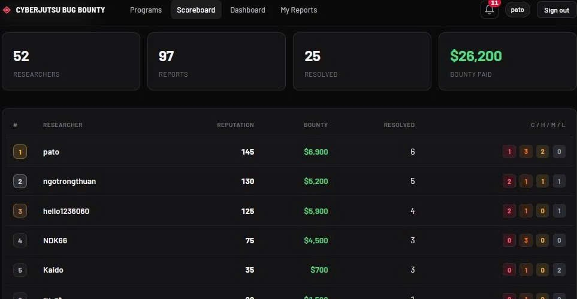

# CyberJutsu Bug Bounty - BrewCart 🎯

> Tổng hợp các báo cáo lỗ hổng bảo mật thực tế được phát hiện trên hệ thống thương mại điện tử **BrewCart**. Đây là một game do CyberJutsu dựng lại để các học viên thi nhau săn bug và có bounty (bounty trên hình chỉ là mô phỏng, không phải thực tế), và mình may mắn đạt được **Top 1**.

---

## 📌 Giới thiệu

Thư mục này lưu trữ các báo cáo chi tiết về những lỗ hổng từ mức độ **Medium** đến **Critical** được khai thác trên ứng dụng web BrewCart và cổng quản trị Admin.

- **Mục tiêu thử nghiệm:**
  - Web Client: `http://brewcart.cyberjutsu-lab.tech`

---

## 📊 Bảng tổng hợp báo cáo lỗ hổng

|  STT   | Tên Lỗ Hổng / Báo Cáo                                                        |    Mức Độ     |     Phân Loại     | Chi tiết Báo Cáo                                               |
| :----: | :--------------------------------------------------------------------------- | :-----------: | :---------------: | :------------------------------------------------------------- |
| **01** | **Broken Access Control dẫn đến lộ Email Admin & Account Takeover**          | 🔴 `Critical` |  Access Control   | [Xem report](./report-broken-access-control-admin-takeover.md) |
| **02** | **SSRF tại endpoint `fetch-image` bypass bảo vệ nội bộ & đọc secret Docker** |   🟠 `High`   |       SSRF        | [Xem report](./SSRF.md)                                        |
| **03** | **Unrestricted File Upload bypass blacklist dẫn đến Stored XSS**             |   🟠 `High`   | File Upload / XSS | [Xem report](./report-file-upload-xss.md)                      |
| **04** | **Race Condition (TOCTOU) bypass giới hạn sử dụng mã giảm giá Coupon**       |  🟡 `Medium`  |  Business Logic   | [Xem report](./report-race-condition-coupon-limit-overrun.md)  |
| **05** | **DOM-based XSS qua tham số tìm kiếm sửa đổi thông tin người dùng**          |   🟠 `High`   |  Client-Side XSS  | [Xem report](./report-dom-xss-profile-tampering.md)            |
