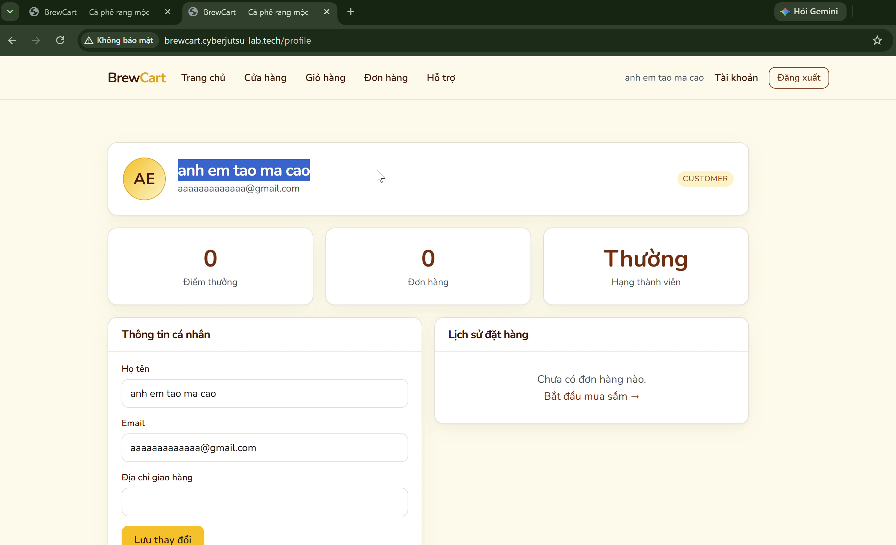
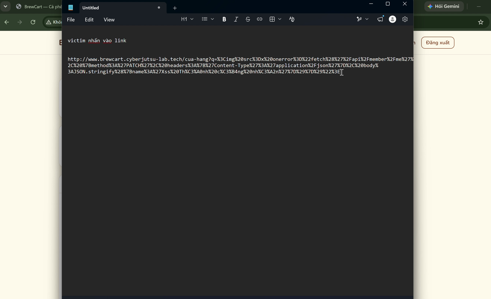
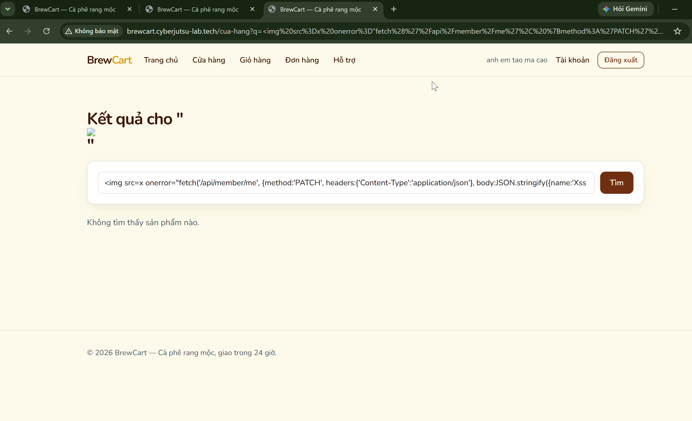
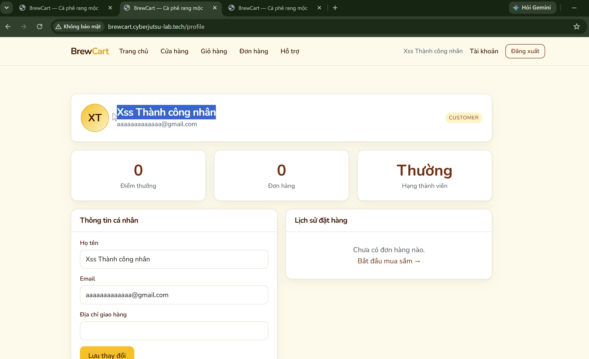

# DOM-based XSS tại /cua-hang qua tham số q dẫn đến thay đổi thông tin tài khoản trái phép

**BrewCart · reported by pato**

## Summary

- **Title:** DOM-based Cross-Site Scripting (DOM XSS) tại `/cua-hang` qua tham số `q` cho phép thực thi script tùy ý và sửa đổi thông tin người dùng
- **Severity:** High
- **Affected asset / URL:**
  - Trang dính lỗ hổng (DOM Sink): `http://brewcart.cyberjutsu-lab.tech/cua-hang?q=<payload>`
  - API bị khai thác trái phép: `PATCH http://brewcart.cyberjutsu-lab.tech/api/member/me`
  - Trang xác nhận kết quả: `http://brewcart.cyberjutsu-lab.tech/profile`

**Precondition:** Nạn nhân đang có một phiên đăng nhập hợp lệ trên ứng dụng và truy cập vào liên kết chứa payload do kẻ tấn công tạo sẵn.

---

## Reproduce

1. **Chuẩn bị payload khai thác:**
   - Kẻ tấn công tạo payload sử dụng thẻ `` với thuộc tính `onerror` để tự động gọi API `PATCH /api/member/me` nhằm thay đổi tên tài khoản (`name`) của nạn nhân mà không cần họ tương tác trực tiếp:
     ```html
     
     ```
   - URL encode payload và chèn vào tham số tìm kiếm `q` của trang cửa hàng:
     ```text
     http://brewcart.cyberjutsu-lab.tech/cua-hang?q=%3Cimg%20src%3Dx%20onerror%3D%22fetch(%27%2Fapi%2Fmember%2Fme%27%2C%7Bmethod%3A%27PATCH%27%2Cheaders%3A%7B%27Content-Type%27%3A%27application%2Fjson%27%7D%2Cbody%3AJSON.stringify(%7Bname%3A%27Xss%20Th%C3%A0nh%20c%C3%B4ng%20nhan%27%7D)%7D)%22%3E
     ```

2. **Gửi liên kết cho nạn nhân:**
   - Gửi liên kết độc hại đã tạo ở bước 1 cho nạn nhân (đang đăng nhập tài khoản có tên hiển thị là `anh em tao ma cao`).

3. **Kích hoạt tải trang và thực thi DOM XSS:**
   - Nạn nhân mở liên kết trên trình duyệt.
   - Client-side script tại trang `/cua-hang` lấy giá trị từ tham số URL `q` và chèn trực tiếp vào DOM tại phần hiển thị "Kết quả cho" mà không mã hóa (HTML entity encoding) hoặc làm sạch (sanitization).
   - Thẻ `` được render vào DOM, trình duyệt gặp lỗi tải ảnh `src=x` và ngay lập tức kích hoạt sự kiện `onerror`, thực thi đoạn script `fetch('/api/member/me', ...)`.
   - Request `PATCH /api/member/me` tự động mang theo session cookie của nạn nhân và cập nhật trường `name` thành `Xss Thành công nhan`.

4. **Xác nhận kết quả tấn công:**
   - Quay lại trang thông tin cá nhân `http://brewcart.cyberjutsu-lab.tech/profile` và làm mới trang.
   - Tên hiển thị và avatar của nạn nhân đã bị thay đổi hoàn toàn thành `Xss Thành công nhan` (avatar ký hiệu `XT`).

---

## Evidence

**Ảnh 1. Thông tin tài khoản của nạn nhân trước khi bị tấn công (Họ tên: `anh em tao ma cao`)**



**Ảnh 2. Link độc hại được chuẩn bị với payload chèn vào tham số `q`**



**Ảnh 3. Trang `/cua-hang` render trực tiếp payload vào DOM và kích hoạt sự kiện onerror gọi API PATCH /api/member/me**



**Ảnh 4. Trang `/profile` sau khi tải lại xác nhận họ tên tài khoản đã bị thay đổi thành `Xss Thành công nhan`**



**_Chi tiết các bước qua video PoC:_**
[PoC Video](https://drive.google.com/file/d/1EVFu4wRdMXJm8bcleMte6_P0Cy_qvTA_/view?usp=sharing)

---

## Impact

- **Thực thi JavaScript tùy ý (Arbitrary Script Execution):** Kẻ tấn công có thể thực thi mã JavaScript bất kỳ trong ngữ cảnh origin `brewcart.cyberjutsu-lab.tech` trên trình duyệt nạn nhân.
- **Thao túng tài khoản & Vượt qua cơ chế CSRF:** Lạm dụng session cookie đang hoạt động để gửi request đến mọi API hỗ trợ xác thực qua cookie (đổi họ tên, địa chỉ giao hàng, hủy đơn hàng, hoặc đánh cắp dữ liệu nhạy cảm PII).
- **Nguy cơ chiếm quyền quản trị (Account Takeover):** Nếu nạn nhân mở liên kết là tài khoản Admin hoặc Staff, kẻ tấn công có thể mượn phiên làm việc để gọi các endpoint quản trị `/api/admin/*`, tạo tài khoản mới, duyệt/sửa dữ liệu đơn hàng và mở rộng bề mặt tấn công vào hệ sinh thái quản trị.

---

## Recommended Remediation

1. **Sử dụng Context-aware DOM Binding an toàn:**
   Tránh sử dụng các thuộc tính sink không an toàn như `innerHTML` hoặc `outerHTML` khi đưa dữ liệu từ URL (`location.search`) lên giao diện. Chuyển sang sử dụng `textContent`, `innerText` hoặc cơ chế data-binding an toàn của framework (ví dụ React JSX text interpolation `{query}` sẽ tự động escape).
2. **HTML Sanitization:**
   Trong trường hợp bắt buộc phải render nội dung HTML phong phú từ input người dùng, bắt buộc phải lọc qua thư viện làm sạch client-side chuyên dụng (như `DOMPurify.sanitize(input)`) trước khi chèn vào DOM.
3. **Triển khai Content Security Policy (CSP):**
   Thiết lập header CSP nghiêm ngặt: loại bỏ `'unsafe-inline'`, yêu cầu nonce hoặc hash cho các script hợp lệ nhằm vô hiệu hóa khả năng kích hoạt của các inline event handler (`onerror`, `onload`, `onclick`).
