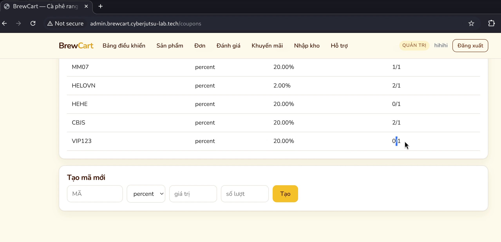
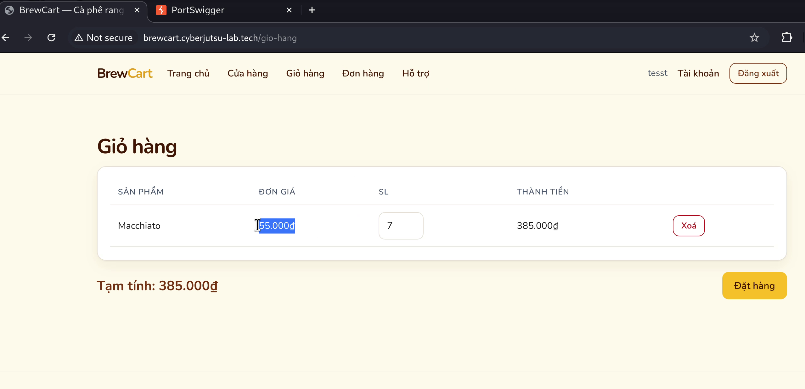
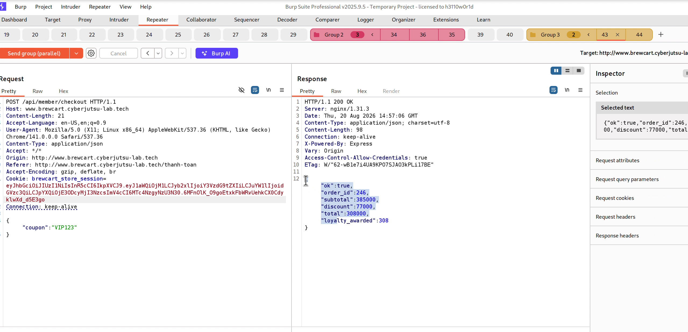
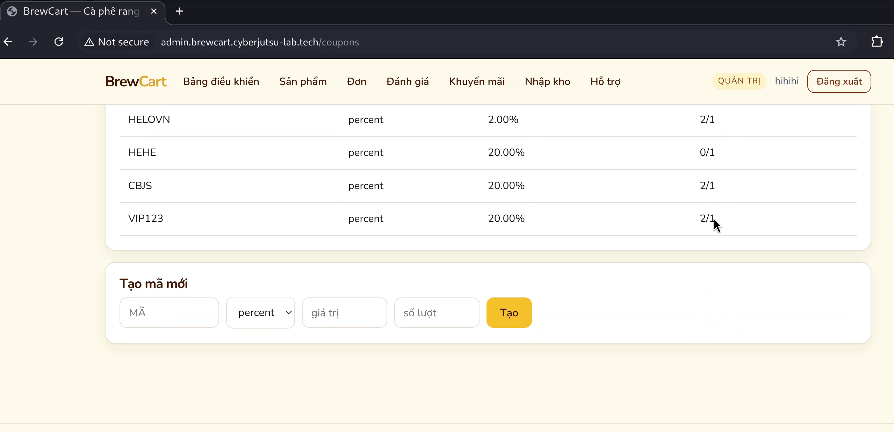
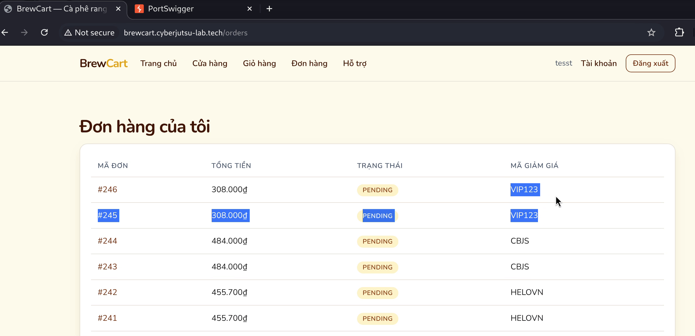

# Race Condition tại /api/member/checkout cho phép vượt qua giới hạn số lượt sử dụng Coupon (Limit Overrun)

**BrewCart · reported by pato**

## Summary

- **Title:** Race Condition (TOCTOU) tại `POST /api/member/checkout` cho phép bypass giới hạn số lượt sử dụng của Coupon (Limit Overrun)
- **Severity:** High
- **Affected asset / URL:**
  - Endpoint thanh toán: `POST http://brewcart.cyberjutsu-lab.tech/api/member/checkout`
  - Quản lý mã giảm giá (Admin): `http://admin.brewcart.cyberjutsu-lab.tech/coupons`
  - Danh sách đơn hàng (Customer): `http://brewcart.cyberjutsu-lab.tech/orders`

**Precondition:** Người dùng đăng nhập tài khoản khách hàng thông thường, có sản phẩm trong giỏ hàng và sở hữu một mã coupon hợp lệ có giới hạn số lượt sử dụng (ví dụ: mã chỉ cho phép sử dụng tối đa 1 lần).

---

## Reproduce

1. **Chuẩn bị môi trường & Coupon:**
   - Đăng nhập tài khoản Admin, truy cập `http://admin.brewcart.cyberjutsu-lab.tech/coupons`.
   - Tạo một mã giảm giá mới:
     - **Mã:** `VIP123`
     - **Loại:** `percent`
     - **Giá trị:** `20` (giảm 20%)
     - **Số lượt:** `1`
   - Xác nhận trong bảng danh sách coupon hiển thị: `VIP123 | percent | 20.00% | 0/1` (đã dùng 0 trên tối đa 1 lượt).

2. **Chuẩn bị giỏ hàng phía Client:**
   - Đăng nhập tài khoản khách hàng thông thường trên `http://brewcart.cyberjutsu-lab.tech`.
   - Thêm sản phẩm vào giỏ hàng (ví dụ: 7 ly Macchiato đơn giá 55.000đ, tổng tiền tạm tính là `385.000đ`).
   - Chuyển đến trang thanh toán `/thanh-toan`.

3. **Gửi đồng thời các request checkout kèm mã giảm giá:**
   - Gửi đồng thời (song song trong cùng một thời điểm) 2 hoặc nhiều request thanh toán mang cùng mã giảm giá `VIP123` tới endpoint `/api/member/checkout`:

     ```http
     POST /api/member/checkout HTTP/1.1
     Host: brewcart.cyberjutsu-lab.tech
     Content-Type: application/json

     {
       "coupon": "VIP123"
     }
     ```

4. **Quan sát phản hồi từ server:**
   - Cả hai request gửi đồng thời đều trả về `HTTP/1.1 200 OK` thành công thay vì chỉ một request thành công và các request sau bị từ chối do hết lượt.
   - Hệ thống sinh ra 2 đơn hàng riêng biệt (`order_id: 245` và `order_id: 246`), cả hai đơn đều được áp dụng đầy đủ chiết khấu 20% (`discount: 77000`, tổng thanh toán giảm từ 385.000đ xuống còn 308.000đ).

5. **Xác nhận kết quả:**
   - Truy cập lại trang quản trị `http://admin.brewcart.cyberjutsu-lab.tech/coupons`:
     - Mã `VIP123` hiển thị số lượt sử dụng là **`2/1`** — vượt quá giới hạn tối đa mà hệ thống cho phép.
     - Quan sát thêm các mã khác trong hệ thống (`HELOVN`, `CBJS`) cũng đều xuất hiện tình trạng tương tự (`2/1`).
   - Truy cập trang lịch sử đơn hàng của khách hàng `http://brewcart.cyberjutsu-lab.tech/orders`:
     - Cả 2 đơn `#245` và `#246` đều tồn tại song song ở trạng thái `PENDING`, cùng áp dụng mã `VIP123` với tổng tiền thanh toán đã giảm còn `308.000đ`.

---

## Evidence

**Ảnh 1 — Tạo mã coupon `VIP123` với giới hạn 1 lượt sử dụng duy nhất (`0/1`)**



**Ảnh 2 — Giỏ hàng của khách hàng có 7 sản phẩm Macchiato với tạm tính 385.000đ**



**Ảnh 3 — Hai request checkout gửi đồng thời đều trả về HTTP 200 OK với mã giảm giá VIP123 được áp dụng**



**Ảnh 4 — Giao diện quản lý coupon xác nhận số lượt sử dụng của VIP123 bị vượt quá giới hạn (`2/1`)**



**Ảnh 5 — Trang đơn hàng của khách hàng ghi nhận cả 2 đơn #245 và #246 đều áp dụng thành công mã VIP123**



**_Chi tiết các bước qua video PoC:_**
[PoC Video](https://drive.google.com/drive/folders/1-hJ7c54SldgBuFips-mzaknBpFEWkbA8?usp=sharing)

---

## Impact

- **Thất thoát tài chính trực tiếp (Financial Loss):** Đối với các chương trình khuyến mãi giảm giá sâu (ví dụ coupon giảm 50%, voucher cố định giá trị cao hoặc mã chỉ áp dụng 1 lần), kẻ tấn công có thể nhân bản một mã duy nhất thành hàng chục lượt mua hàng giảm giá, gây thiệt hại nghiêm trọng về doanh thu cho doanh nghiệp.
- **Gian lận điểm thưởng / Reward Abuse:** Mỗi đơn hàng checkout thành công đều phát sinh điểm thưởng thành viên (`daily_reward`). Việc nhân bản đơn hàng cho phép tích lũy điểm thưởng trái phép.
- **Khả năng tự động hóa và mở rộng cao (Scalability):** Bằng cách gửi hàng chục request đồng thời (single-packet attack), số lượt vượt giới hạn có thể nhân rộng quy mô lớn hơn nhiều so với 2 request trong PoC cơ bản.

---

## Recommended Remediation

1. **Atomic Update:** Cập nhật số lượt dùng bằng câu lệnh nguyên tử kèm điều kiện trực tiếp:
   ```sql
   UPDATE coupons SET usage_count = usage_count + 1 WHERE code = :code AND usage_count < max_usage;
   ```
   Nếu `affected_rows == 0`, hủy giao dịch và từ chối áp dụng coupon.
2. **Pessimistic Locking:** Sử dụng `SELECT ... FOR UPDATE` trên dòng dữ liệu coupon trong database transaction khi xử lý checkout để tuần tự hóa các request cùng mã.
3. **Distributed Lock & Idempotency:** Với hệ thống phân tán, dùng Redis Mutex Lock theo `coupon_code` và áp dụng idempotency key hoặc rate limiting trên endpoint `/api/member/checkout`.
