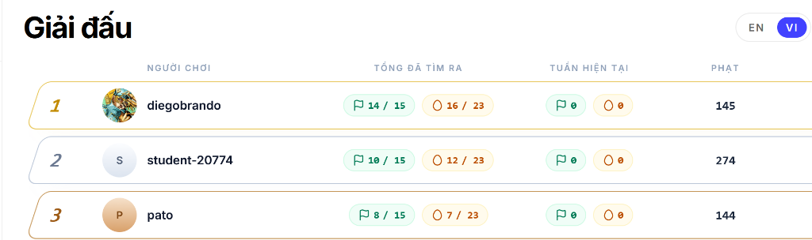

# CyberJutsu League - Season 1 🥷

> Đây tổng hợp writeup và phân tích chi tiết các thử thách trong giải đấu **CyberJutsu League - Season 1** bởi mình, và mình may mắn đạt được top 3.

---

## 📌 Giới thiệu

Thư mục này lưu trữ lời giải, flow tư duy khai thác và source code/script minh họa cho toàn bộ các bài CTF qua 4 tuần thi đấu của CyberJutsu League Season 1, trải dài từ Web Exploitation, Cryptography cho đến Binary Exploitation (Pwn).

👉 **[Đọc toàn bộ Writeup chi tiết tại đây](./Writeup.md)**

---

## 🧭 Mục lục thử thách

| Tuần       | Thử thách                  |    Phân loại     | Kỹ thuật / Lỗ hổng chính                                                                |
| :--------- | :------------------------- | :--------------: | :-------------------------------------------------------------------------------------- |
| **Week 1** | **Iox Framework**          |      `Web`       | Phân tích mã nguồn PHP, Module Dispatcher Bug, Dynamic Call                             |
|            | **Meme**                   |      `Web`       | File Upload Bypass, Fake MIME Type, Web Shell                                           |
| **Week 2** | **PHP Lixi**               |      `Web`       | Khai thác ký tự ẩn Unicode (`e2 81 a3`), PHP Eval Injection                             |
|            | **Cybershare**             |      `Web`       | XSS, JWT Manipulation, PHP Object Injection (Insecure Deserialization)                  |
| **Week 3** | **The Archivist’s Fault**  |     `Crypto`     | RSA Signature Forgery, Negative Index Slip Bypass                                       |
|            | **EggRoll Silent Orchard** | `Crypto` / `Pwn` | ECDSA Nonce Reuse, Stack Pivoting, RBP Hijack, SUID Privilege Escalation                |
| **Week 4** | **Rock, Paper, Scissor**   |      `Pwn`       | Buffer Overflow, Off-by-one Null Byte, GOT Overwrite, Format String Leak Libc, Ret2Libc |
